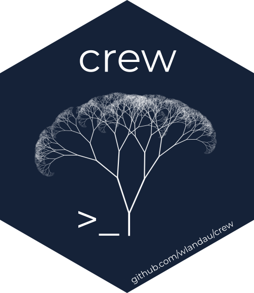
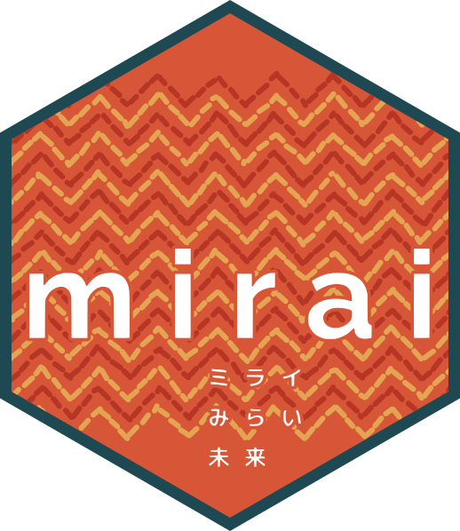
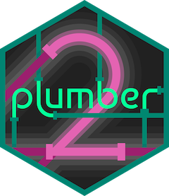
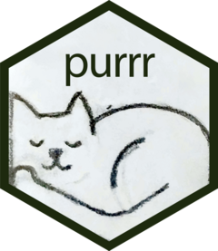
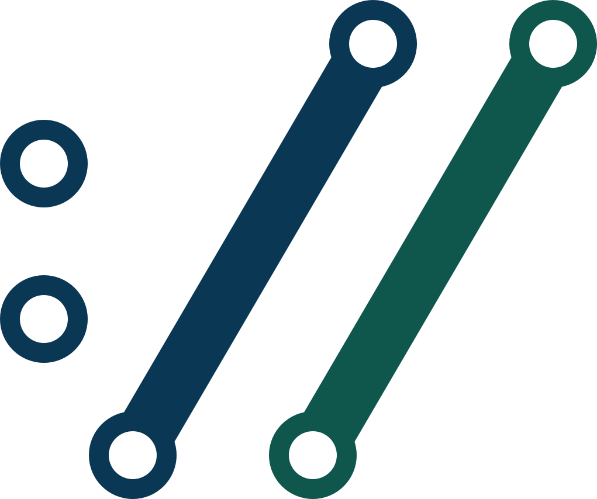

```{r}
#| label: setup
#| include: false

# Data: bench-data.R reads ../tidymodels-parallel-benchmark/results/*.rds and
# builds `fits` (12-worker speed-up, implied serial %, ceiling), `busy`
# (worker cores over time), `runs`, `meta`, plus the label vectors.
# The deck's evidence is the speaker's own runtimes only: the codenamed
# backend's rows are filtered out below (full comparison saved for the
# report). Unused from bench-data.R in this pass: `karp_flatt`, `monitors`,
# `everywhere_d`.
source("bench-data.R")

suppressPackageStartupMessages(library(ggplot2))

fits <- fits |> filter(backend != "fescue") |> droplevels()
busy <- busy |> filter(backend != "fescue") |> droplevels()

theme_set(theme_bw(base_size = 20))

# Backend colours stay fixed across every figure (outline.md style rule).
backend_cols <- c(
  "mirai" = "#1B9E77",
  "mizu" = "#E7298A"
)

fmt <- function(x, d = 1) formatC(x, digits = d, format = "f")

# Inline-number accessors, so prose and figures come from the same objects.
fit_row <- function(wl, be) {
  fits |>
    filter(workload == wl_label[[wl]], backend == backend_label[[be]])
}
sp <- function(wl, be, d = 1) fmt(fit_row(wl, be)$mean_speedup, d)
mc <- function(wl, be, d = 1) {
  busy |>
    filter(workload == wl_label[[wl]], backend == backend_label[[be]]) |>
    pull(cores) |>
    mean() |>
    fmt(d)
}
par_runs <- runs |>
  filter(backend != "future") |>
  mutate(
    workload = factor(wl_label[workload], levels = wl_label),
    backend = factor(backend_label[backend], levels = names(backend_cols)),
    n = workers
  )

# F3: 12-worker speed-ups, one workload or all four (benchmark.qmd `speedups`)
plot_speedup <- function(wl = NULL) {
  d <- par_runs
  if (!is.null(wl)) d <- d |> filter(workload == wl_label[[wl]])
  p <- ggplot(d, aes(backend, speed_up, col = backend)) +
    geom_hline(yintercept = 1, lty = 2, col = "red") +
    geom_hline(yintercept = workers, lty = 2, col = "darkgreen") +
    geom_jitter(width = 0.08, alpha = 3 / 4, cex = 2.5, seed = 1) +
    scale_color_manual(values = backend_cols) +
    labs(x = NULL, y = "speed-up vs sequential", col = NULL)
  if (!is.null(wl)) {
    p + theme(legend.position = "none")
  } else {
    p +
      facet_wrap(~workload) +
      theme(legend.position = "top", axis.text.x = element_blank())
  }
}

# F6, §1 form: measured speed-ups at 2/4/8/12 workers (solid) against the
# Amdahl prediction pinned at each backend's 12-worker mean (dotted). The
# sweep covers B and C only — there are no sub-12-worker runs on A. future
# is filtered out with the rest of the deck (benchmark.qmd `amdahl-sweep`)
sweep_meas <- sweep_raw$timings |>
  filter(!backend %in% c("sequential", "future")) |>
  inner_join(sweep_base, by = "workload") |>
  mutate(
    speed_up = baseline / elapsed,
    workload = factor(wl_label[workload], levels = wl_label),
    backend = factor(backend_label[backend], levels = names(backend_cols))
  )

sweep_n <- max(sweep_raw$timings$workers)

sweep_pred <- sweep_meas |>
  filter(workers == sweep_n) |>
  summarize(s_top = mean(speed_up), .by = c(workload, backend)) |>
  mutate(p = (1 - 1 / s_top) / (1 - 1 / sweep_n)) |>
  reframe(tibble(n = seq(1, sweep_n, by = 0.25)), .by = c(workload, backend, p)) |>
  mutate(speedup = amdahl(n, p))

plot_sweep <- function() {
  ggplot(sweep_meas, aes(workers, speed_up, col = backend)) +
    geom_abline(slope = 1, intercept = 0, lty = 2, col = "grey50") +
    geom_line(data = sweep_pred, aes(n, speedup), lty = 3, linewidth = 0.7) +
    geom_point(
      alpha = 1 / 2, cex = 1.5,
      position = position_jitter(width = 0.12, height = 0, seed = 1)
    ) +
    stat_summary(fun = mean, geom = "line", linewidth = 0.8) +
    stat_summary(fun = mean, geom = "point", cex = 2.5) +
    facet_wrap(~workload) +
    scale_color_manual(values = backend_cols) +
    scale_x_continuous(breaks = c(2, 4, 8, 12)) +
    labs(x = "workers", y = "speed-up vs sequential", col = NULL) +
    theme(legend.position = "top")
}

# F4/F7: busy worker cores over time, one workload (benchmark.qmd `cpu-aggregate`)
plot_busy <- function(wl) {
  busy |>
    filter(workload == wl_label[[wl]]) |>
    ggplot(aes(rel_time, cores, col = backend)) +
    geom_hline(yintercept = workers, lty = 2, col = "darkgreen") +
    geom_line(linewidth = 0.7) +
    scale_color_manual(values = backend_cols) +
    labs(x = "seconds into run", y = "busy worker cores", col = NULL) +
    theme(legend.position = "top")
}

```

# {.center data-menu-title="0 · Cold open"}

::: {.statement}
Your bootstrap is embarrassingly parallel<br>So why did twelve workers only give you 2x?
:::

## Twelve workers, one bootstrap {.fig-focus}

```{r}
#| label: fig-speedup-a
#| fig-width: 10
#| fig-height: 5.8
#| fig-dpi: 192

plot_speedup("boot_metrics")
```

::: {.receipt}
Early results · 12 workers, 14-core M4 Pro · R 4.6.1 · sequential `lapply()` baseline = 1× · both runtimes' outputs match the sequential run
:::

## `daemons()` + `mirai_map()` {data-menu-title="2 · code" data-state="sec-2"}

```r
library(mirai)
daemons(12)

res <- mirai_map(splits, function(split) {
  # fit, score, return a tibble
})[]
```

# The evidence: four workloads {data-menu-title="The workloads" data-state="sec-1"}

::: {.statement}
Four workflows you already run —<br>chosen to stress the transport regimes that separate parallel runtimes
:::

## Four workloads {.smaller data-state="sec-1"}

::: {.tbl}
```{r}
#| label: tbl-workloads

tibble(
  Workload = unname(wl_label),
  Tasks = as.integer(meta$n_tasks[names(wl_label)]),
  `Per-task cost` = c("~3 ms", "~45 ms", "~85 ms", "~90 ms"),
  `Per-task input` = c(
    "1 bootstrap split (~200 KB)",
    "1 bootstrap split (~1.7 MB)",
    "1 bootstrap replicate (~2.8 MB)",
    "1 bootstrap split (~3.4 MB)"
  ),
  `Shared input` = c(
    "—", "—", "fitted glm (0.2 MB)", "38 MB portfolio (250k policies)"
  ),
  `Per-task result` = c(
    "4-row tibble", "2-row tibble", "30-row tibble", "250k-vector (2 MB)"
  )
) |>
  knitr::kable()
```
:::

## A — Overhead-bound: thousands of tiny tasks {.smaller data-state="sec-1"}

```r
# A: yardstick metrics on one bootstrap split
task_metrics <- function(split) {
  require(rsample)
  require(yardstick)
  mtr <- metric_set(rmse, rsq, mae, ccc)
  mtr(analysis(split), y, .pred)
}
```

5,000 × ~3 ms — at this grain, the per-task transport rivals the compute itself

## B — The everyday workflow {.smaller data-state="sec-1"}

```r
# B: parsnip workflow fit on the analysis set, scored out-of-bag
task_fit_glm <- function(split) {
  wf <- workflow() |>
    add_recipe(recipe(class ~ ., data = analysis(split)) |>
                 step_normalize(all_numeric_predictors())) |>
    add_model(logistic_reg() |> set_engine("glm"))

  fitted <- fit(wf, data = analysis(split))
  pred <- bind_cols(predict(fitted, assessment(split), type = "prob"),
                    predict(fitted, assessment(split), type = "class"))
  bind_rows(roc_auc(pred, class, .pred_yes),
            accuracy(pred, class, .pred_class))
}
```

`fit_resamples()` on a recipe + logistic regression — 250 × ~45 ms, ~1.7 MB riding inside each split

## C — Large payloads, a shared model {.smaller data-state="sec-1"}

```r
# C: one bootstrap replicate of the validation set; permute each
# predictor in turn and record the AUC drop against the pre-fit model
task_permimp <- function(task, model) {
  set.seed(task$seed, kind = "Mersenne-Twister")  # streams comparable across backends
  dat <- analysis(task$split); truth <- dat$y
  base_auc <- roc_auc_vec(truth, predict(model, dat, type = "response"), event_level = "second")

  for (col in setdiff(colnames(dat), "y")) {
    shuffled <- dat |> mutate(!!col := sample(.data[[col]]))
    importance[col] <- base_auc -
      roc_auc_vec(truth, predict(model, shuffled, type = "response"), event_level = "second")
  }
  tibble(col = names(importance), base_auc, importance)
}
```

240 × ~85 ms; ~2.8 MB per replicate, plus the fitted model every replicate scores with

## D — Broadcast in, bulk out {.smaller data-state="sec-1"}

```r
# D: refit the severity model on one bootstrap split and predict
# expected loss for every policy in the shared portfolio
task_bootpred <- function(split, portfolio) {
  require(rsample)
  fit <- glm(loss ~ ., data = analysis(split),
             family = Gamma(link = "log"), control = list(maxit = 25))
  as.numeric(predict(fit, newdata = portfolio, type = "response"))
}
```

400 × ~90 ms · a 38 MB shared portfolio · 800 MB of results on the way back

# The hidden ceiling {data-menu-title="1 · The ceiling" data-state="sec-1"}

## Amdahl's law {.fig-focus .amdahl data-state="sec-1"}

$$S(n) = \frac{1}{(1 - p) + \dfrac{p}{n}} \;\xrightarrow[n \to \infty]{}\; \frac{1}{1 - p}$$

```{r}
#| label: fig-sweep
#| fig-width: 10
#| fig-height: 5.3
#| fig-dpi: 192

plot_sweep()
```

**mizu adheres to the law**; mirai falls away

## Same busyness, different clocks {.fig-focus data-state="sec-1"}

```{r}
#| label: fig-busy-a
#| fig-width: 10
#| fig-height: 6.2
#| fig-dpi: 192

plot_busy("boot_metrics")
```

# Stop waiting. Stream the work. Same code everywhere {data-menu-title="2 · mirai" data-state="sec-2"}

## Where mirai started {data-menu-title="2 · origins" data-state="sec-2"}

```{=html}
<div class="hex-wall">
  <div class="hex-item"><span class="hex-name">targets</span></div>
  <span style="align-self: center; font-size: 0.8em; color: var(--muted);">→</span>
  <div class="hex-item"><span class="hex-name">crew</span></div>
  <span style="align-self: center; font-size: 0.8em; color: var(--muted);">→</span>
  <div class="hex-item"><span class="hex-name">mirai</span></div>
</div>
```

::: {.statement}
mirai began as the engine under crew and targets
:::

## Your R session is an event loop {data-menu-title="2 · event loop" data-state="sec-2"}

::: {.fragment .fade-up data-fragment-index="1"}
::: {.statement}
Async is never waiting for a result
:::
:::

::: {.scene}
```{=html}
<svg viewBox="0 0 1000 530" role="img" aria-label="Why async matters: left, a long chain blocks the session and everything waits; right, mirai hands the task to a daemon, the session stays live, and the result lands when it is ready">
  <defs>
    <marker id="arrow" viewBox="0 0 10 10" refX="9" refY="5" markerWidth="7" markerHeight="7" orient="auto-start-reverse">
      <path d="M0,0 L10,5 L0,10 z" fill="#404041"/>
    </marker>
  </defs>

  <!-- LEFT — blocking: the task runs in the session -->
  <rect class="machine" x="40" y="70" width="440" height="360" rx="16"/>
  <text class="machine-label" x="72" y="126" text-anchor="start" font-size="34">blocking</text>

  <circle class="user-dot" cx="95" cy="215" r="12" style="fill: var(--muted);"/>
  <circle class="user-dot" cx="95" cy="265" r="12" style="fill: var(--muted);"/>
  <circle class="user-dot" cx="95" cy="315" r="12" style="fill: var(--muted);"/>
  <text class="machine-sub" x="95" y="362" text-anchor="middle" font-size="18">waiting…</text>
  <image href="images/shiny-logo.png" x="71" y="370" width="48" height="55"/>
  <path class="flow" d="M110,265 L146,265"/>

  <rect class="node" x="150" y="195" width="180" height="150" rx="14"/>
  <text class="node-label" x="240" y="230" text-anchor="middle" font-size="22">R session</text>
  <path d="M240,262 A38,38 0 1 1 239,262" fill="none" stroke="var(--muted)" stroke-width="3.5" stroke-dasharray="7 6"/>
  <rect x="182" y="280" width="116" height="40" rx="8" fill="var(--danger)"/>
  <text x="240" y="307" text-anchor="middle" font-size="18" font-weight="700" fill="#ffffff">30 min chain</text>
  <text x="240" y="394" text-anchor="middle" font-size="22" fill="var(--danger)">session blocked</text>

  <!-- RIGHT — async: the task is handed off (fragment reveal; shares index 1 with the statement above so they appear together) -->
  <g class="fragment" data-fragment-index="1">
  <rect class="machine" x="520" y="70" width="440" height="360" rx="16"/>
  <text class="machine-label" x="552" y="126" text-anchor="start" font-size="34">async</text>

  <circle class="user-dot" cx="575" cy="215" r="12"/>
  <circle class="user-dot" cx="575" cy="265" r="12"/>
  <circle class="user-dot" cx="575" cy="315" r="12"/>
  <path class="flow" d="M590,265 L626,265"/>

  <rect class="node" x="630" y="195" width="180" height="150" rx="14"/>
  <text class="node-label" x="720" y="230" text-anchor="middle" font-size="22">R session</text>
  <path d="M720,262 A38,38 0 1 1 719,262" fill="none" stroke="var(--safe)" stroke-width="3.5" marker-end="url(#arrow)"/>

  <rect class="chip" x="862" y="262" width="78" height="76" rx="10"/>
  <text class="chip-label" x="901" y="307" text-anchor="middle" font-size="18">daemon</text>
  <path class="flow" d="M812,300 L858,300"/>
  <rect x="825" y="290" width="20" height="20" rx="4" fill="var(--posit-blue)"/>
  <path class="flow" d="M901,340 C901,380 782,392 732,350"/>

  <circle cx="748" cy="268" r="16" fill="var(--safe)"/>
  <path d="M740,268 L746,274 L757,262" fill="none" stroke="#ffffff" stroke-width="3.5" stroke-linecap="round" stroke-linejoin="round"/>
  <line x1="766" y1="252" x2="776" y2="242" stroke="var(--safe)" stroke-width="3.5" stroke-linecap="round"/>
  <line x1="772" y1="270" x2="783" y2="268" stroke="var(--safe)" stroke-width="3.5" stroke-linecap="round"/>
  <text x="720" y="394" text-anchor="middle" font-size="22" fill="var(--safe)">session stays live</text>

  <!-- caption -->
  <text class="caption" x="500" y="475" text-anchor="middle" font-size="30">The task runs off the session — the result lands when it's ready</text>
  <!-- API label: hero size, as built in Houston -->
  <text class="diagram-mono" data-id="apilbl" x="500" y="520" text-anchor="middle" style="font-size: 40px;">mirai(long_task())</text>
  </g>
</svg>
```
:::

## A future you still wait for {data-menu-title="2 · futures" data-state="sec-2"}

```r
# 1 · base R parallel — one blocking call
res <- parallel::parLapply(cl, tasks, fn)

# 2 · future — a handle, but you still wait
f <- future::future(fit(x))
v <- future::value(f)
# promises poll every 100ms

# 3 · mirai — the handle wakes the event loop
m <- mirai::mirai(fit(x), .args = list(x = x))
v <- m[]
# event-driven promises
```

## Push, stream, steal {data-menu-title="2 · dispatch" data-state="sec-2"}

::: {.scene}
```{=html}
<svg viewBox="0 0 1000 530" role="img" aria-label="Three generations of getting work to workers: push serialises per-worker chunks while workers idle, a streaming dispatcher hands out one task at a time, and workers steal tasks straight off shared pages">
  <defs>
    <marker id="arrow" viewBox="0 0 10 10" refX="9" refY="5" markerWidth="7" markerHeight="7" orient="auto-start-reverse">
      <path d="M0,0 L10,5 L0,10 z" fill="#404041"/>
    </marker>
  </defs>

  <!-- 1 · Push — parallel::parLapply(): chunks serialised in turn -->
  <text class="node-label" x="30" y="65" font-size="26">1 · Push</text>
  <text class="diagram-mono" x="30" y="97" font-size="18">parallel::parLapply()</text>
  <rect class="node" x="270" y="50" width="140" height="80" rx="12"/>
  <text class="node-label" x="340" y="97" text-anchor="middle" font-size="18">R session</text>
  <path class="flow" d="M410,42 L822,42"/>
  <path class="flow" d="M410,90 L822,90"/>
  <path class="flow" d="M410,138 L822,138"/>
  <rect class="payload" x="660" y="32" width="110" height="20" rx="4"/>
  <rect class="payload" x="540" y="80" width="110" height="20" rx="4"/>
  <rect class="payload" x="420" y="128" width="110" height="20" rx="4"/>
  <rect class="chip" x="830" y="23" width="140" height="38" rx="8"/>
  <rect class="chip" x="830" y="71" width="140" height="38" rx="8"/>
  <rect class="chip" x="830" y="119" width="140" height="38" rx="8"/>
  <text class="chip-label" x="900" y="47" text-anchor="middle" font-size="15">worker</text>
  <text class="chip-label" x="900" y="95" text-anchor="middle" font-size="15">worker</text>
  <text class="chip-label" x="900" y="143" text-anchor="middle" font-size="15">worker</text>
  <text class="machine-sub" x="615" y="160" text-anchor="middle" font-size="15">chunks serialised in turn — workers idle until theirs arrives</text>
  <line x1="30" y1="172" x2="970" y2="172" stroke="#c9d1d9" stroke-width="1"/>

  <!-- 2 · Stream — mirai: a dispatcher hands out one task at a time -->
  <text class="node-label" x="30" y="235" font-size="26">2 · Stream</text>
  <text class="diagram-mono" x="30" y="267" font-size="18">mirai_map()</text>
  <rect class="node" x="270" y="220" width="140" height="80" rx="12"/>
  <text class="node-label" x="340" y="267" text-anchor="middle" font-size="18">R session</text>
  <rect class="relay" x="500" y="230" width="130" height="60" rx="8"/>
  <text class="relay-label" x="565" y="266" text-anchor="middle" font-size="15">dispatcher</text>
  <path class="flow" d="M410,260 L494,260"/>
  <circle class="user-dot" cx="452" cy="260" r="7"/>
  <path class="flow" d="M630,260 L816,214"/>
  <path class="flow" d="M630,260 L822,260"/>
  <path class="flow" d="M630,260 L816,306"/>
  <circle class="user-dot" cx="723" cy="237" r="7"/>
  <circle class="user-dot" cx="726" cy="260" r="7"/>
  <circle class="user-dot" cx="723" cy="283" r="7"/>
  <rect class="chip" x="830" y="193" width="140" height="38" rx="8"/>
  <rect class="chip" x="830" y="241" width="140" height="38" rx="8"/>
  <rect class="chip" x="830" y="289" width="140" height="38" rx="8"/>
  <text class="chip-label" x="900" y="217" text-anchor="middle" font-size="15">worker</text>
  <text class="chip-label" x="900" y="265" text-anchor="middle" font-size="15">worker</text>
  <text class="chip-label" x="900" y="313" text-anchor="middle" font-size="15">worker</text>
  <text class="machine-sub" x="615" y="330" text-anchor="middle" font-size="15">one task at a time, the moment a worker frees up</text>
  <line x1="30" y1="342" x2="970" y2="342" stroke="#c9d1d9" stroke-width="1"/>

  <!-- 3 · Steal — mizu (§4): workers claim tasks off shared pages -->
  <text class="node-label" x="30" y="405" font-size="26">3 · Steal</text>
  <text class="diagram-mono" x="30" y="437" font-size="18">mizu_map()</text>
  <text class="machine-sub" x="146" y="437" font-size="15">§4</text>
  <rect class="plane" x="270" y="375" width="140" height="110" rx="12"/>
  <circle class="user-dot" cx="310" cy="395" r="7"/>
  <circle class="user-dot" cx="340" cy="395" r="7"/>
  <circle class="user-dot" cx="370" cy="395" r="7"/>
  <text class="plane-label" x="340" y="428" text-anchor="middle" font-size="18">shared</text>
  <text class="plane-label" x="340" y="450" text-anchor="middle" font-size="18">pages</text>
  <path class="flow" d="M410,430 L816,384"/>
  <path class="flow" d="M410,430 L822,430"/>
  <path class="flow" d="M410,430 L816,476"/>
  <circle class="user-dot" cx="613" cy="407" r="7"/>
  <circle class="user-dot" cx="616" cy="430" r="7"/>
  <circle class="user-dot" cx="613" cy="453" r="7"/>
  <rect class="chip" x="830" y="363" width="140" height="38" rx="8"/>
  <rect class="chip" x="830" y="411" width="140" height="38" rx="8"/>
  <rect class="chip" x="830" y="459" width="140" height="38" rx="8"/>
  <text class="chip-label" x="900" y="387" text-anchor="middle" font-size="15">worker</text>
  <text class="chip-label" x="900" y="435" text-anchor="middle" font-size="15">worker</text>
  <text class="chip-label" x="900" y="483" text-anchor="middle" font-size="15">worker</text>
  <text class="machine-sub" x="615" y="505" text-anchor="middle" font-size="15">no dispatcher in the loop — workers claim tasks off the pages</text>
</svg>
```
:::

## Why learn a new map? {.code-hero data-menu-title="2 · new map" data-state="sec-2"}

```r
cl <- parallel::makeCluster(12, type = "MIRAI")
res <- parallel::parLapply(cl, tasks, fn)
```

The old interface runs on mirai daemons today. Two things it can't give you:

- **The overhead stays** — `parLapply()` is the push model: static chunks, blocking collect, §1's costs in full
- **It can't say async** — no separate collect (`[]` when you're ready), no event-driven promises; the call returns when the last task does

::: {.muted}
`type = "MIRAI"` is native in R ≥ 4.5 — `mirai::make_cluster(12)` on older R
:::

## One machine {auto-animate=true data-menu-title="2 · scale · A" data-state="sec-2"}

::: {.scene}
```{=html}
<svg viewBox="0 0 1000 530" role="img" aria-label="Scene A: a laptop running an R session with three local daemons">
  <defs>
    <marker id="arrow" viewBox="0 0 10 10" refX="9" refY="5" markerWidth="7" markerHeight="7" orient="auto-start-reverse">
      <path d="M0,0 L10,5 L0,10 z" fill="#404041"/>
    </marker>
  </defs>

  <!-- tasks -->
  <circle class="user-dot" data-id="u1" cx="45" cy="140" r="12"/>
  <circle class="user-dot" data-id="u2" cx="45" cy="190" r="12"/>
  <circle class="user-dot" data-id="u3" cx="45" cy="240" r="12"/>
  <circle class="user-dot" data-id="u4" cx="45" cy="290" r="12"/>
  <circle class="user-dot" data-id="u5" cx="45" cy="340" r="12"/>
  <text class="node-label" data-id="ulbl" x="45" y="378" text-anchor="middle" font-size="18">tasks</text>
  <path class="flow" data-id="f1" d="M75,240 L214,240"/>

  <!-- your laptop: session + local daemons -->
  <rect class="machine" data-id="m0" x="220" y="95" width="478.0" height="260.7" rx="20.3"/>
  <text class="machine-label" data-id="m0l" x="251.9" y="135.6" text-anchor="start" font-size="26">your laptop</text>
  <text class="diagram-mono" data-id="m0a" x="666.1" y="135.6" text-anchor="end" font-size="22">daemons(3)</text>
  <rect class="node" data-id="host" x="249.0" y="167.4" width="181.1" height="144.8" rx="14.5"/>
  <text class="node-label" data-id="hlbl" x="338.8" y="250.0" text-anchor="middle" font-size="26">R session</text>
  <rect class="chip" data-id="c01" x="480.7" y="164.5" width="181.1" height="52.1" rx="11.6"/>
  <text class="chip-label" data-id="cl1" x="570.5" y="197.8" text-anchor="middle" font-size="18">daemon</text>
  <rect class="chip" data-id="c02" x="480.7" y="228.3" width="181.1" height="52.1" rx="11.6"/>
  <text class="chip-label" data-id="cl2" x="570.5" y="261.6" text-anchor="middle" font-size="18">daemon</text>
  <rect class="chip" data-id="c03" x="480.7" y="292.0" width="181.1" height="52.1" rx="11.6"/>
  <text class="chip-label" data-id="cl3" x="570.5" y="325.3" text-anchor="middle" font-size="18">daemon</text>
  <path class="flow" data-id="fl1" d="M430.0,206.5 L474.9,190.6"/>
  <path class="flow" data-id="fl2" d="M430.0,239.8 L474.9,254.3"/>
  <path class="flow" data-id="fl3" d="M430.0,273.2 L474.9,318.1"/>

  <!-- arm 1: your own servers, over SSH -->
  <path class="flow" data-id="a1" d="M484,222 L604,96" style="opacity: 0;"/>
  <rect class="machine" data-id="m1" x="610" y="40" width="350" height="100" rx="14" style="opacity: 0;"/>
  <text class="machine-label" data-id="m1l" x="632" y="70" text-anchor="start" font-size="18" style="opacity: 0;">your servers</text>
  <text class="diagram-mono" data-id="m1a" x="938" y="70" text-anchor="end" font-size="15" style="opacity: 0;">ssh_config()</text>
  <rect class="chip" data-id="c11" x="636" y="92" width="66" height="34" rx="7" style="opacity: 0;"/>
  <rect class="chip" data-id="c12" x="714" y="92" width="66" height="34" rx="7" style="opacity: 0;"/>
  <rect class="chip" data-id="c13" x="792" y="92" width="66" height="34" rx="7" style="opacity: 0;"/>
  <rect class="chip" data-id="c14" x="870" y="92" width="66" height="34" rx="7" style="opacity: 0;"/>

  <!-- arm 2: HPC cluster, through the scheduler -->
  <path class="flow" data-id="a2" d="M484,236 L604,231" style="opacity: 0;"/>
  <rect class="relay" data-id="r2" x="502" y="216" width="84" height="34" rx="8" style="opacity: 0;"/>
  <text class="relay-label" data-id="r2l" x="544" y="238" text-anchor="middle" font-size="15" style="opacity: 0;">scheduler</text>
  <rect class="machine" data-id="m2" x="610" y="160" width="350" height="142" rx="14" style="opacity: 0;"/>
  <text class="machine-label" data-id="m2l" x="632" y="190" text-anchor="start" font-size="18" style="opacity: 0;">HPC cluster</text>
  <text class="diagram-mono" data-id="m2a" x="938" y="190" text-anchor="end" font-size="15" style="opacity: 0;">cluster_config()</text>
  <rect class="chip" data-id="c21" x="636" y="208" width="66" height="34" rx="7" style="opacity: 0;"/>
  <rect class="chip" data-id="c22" x="714" y="208" width="66" height="34" rx="7" style="opacity: 0;"/>
  <rect class="chip" data-id="c23" x="792" y="208" width="66" height="34" rx="7" style="opacity: 0;"/>
  <rect class="chip" data-id="c24" x="870" y="208" width="66" height="34" rx="7" style="opacity: 0;"/>
  <rect class="chip" data-id="c25" x="636" y="252" width="66" height="34" rx="7" style="opacity: 0;"/>
  <rect class="chip" data-id="c26" x="714" y="252" width="66" height="34" rx="7" style="opacity: 0;"/>
  <rect class="chip" data-id="c27" x="792" y="252" width="66" height="34" rx="7" style="opacity: 0;"/>
  <rect class="chip" data-id="c28" x="870" y="252" width="66" height="34" rx="7" style="opacity: 0;"/>

  <!-- arm 3: any REST API — cloud, Kubernetes, Workbench -->
  <path class="flow" data-id="a3" d="M484,290 L604,366" style="opacity: 0;"/>
  <rect class="relay" data-id="r3" x="506" y="311" width="76" height="34" rx="8" style="opacity: 0;"/>
  <text class="relay-label" data-id="r3l" x="544" y="333" text-anchor="middle" font-size="13" style="opacity: 0;">REST API</text>
  <rect class="machine" data-id="m3" x="610" y="312" width="350" height="128" rx="14" style="opacity: 0;"/>
  <text class="machine-label" data-id="m3l" x="632" y="342" text-anchor="start" font-size="18" style="opacity: 0;">Kubernetes · cloud</text>
  <text class="diagram-mono" data-id="m3a" x="938" y="342" text-anchor="end" font-size="15" style="opacity: 0;">http_config()</text>
  <rect class="chip" data-id="c31" x="636" y="358" width="66" height="34" rx="7" style="opacity: 0;"/>
  <rect class="chip" data-id="c32" x="714" y="358" width="66" height="34" rx="7" style="opacity: 0;"/>
  <rect class="chip" data-id="c33" x="792" y="358" width="66" height="34" rx="7" style="opacity: 0;"/>
  <rect class="chip" data-id="c34" x="870" y="358" width="66" height="34" rx="7" style="opacity: 0;"/>
  <text class="machine-sub" data-id="m3sub" x="785" y="422" text-anchor="middle" font-size="15" style="opacity: 0;">…including Posit Workbench, auto-configured</text>

  <!-- caption -->
  <text class="caption" data-id="captext" x="500" y="475" text-anchor="middle" font-size="30">One machine — your session and its daemons</text>
  <text class="diagram-mono" data-id="apilbl" x="500" y="520" text-anchor="middle" font-size="30" style="opacity: 0;">ssh_config() · cluster_config() · http_config()</text>
</svg>
```
:::

## Your own servers, over SSH {auto-animate=true data-menu-title="2 · scale · B" data-state="sec-2"}

::: {.scene}
```{=html}
<svg viewBox="0 0 1000 530" role="img" aria-label="Scene B: the laptop reaches out over SSH to a server running four daemons">
  <defs>
    <marker id="arrow" viewBox="0 0 10 10" refX="9" refY="5" markerWidth="7" markerHeight="7" orient="auto-start-reverse">
      <path d="M0,0 L10,5 L0,10 z" fill="#404041"/>
    </marker>
  </defs>

  <!-- tasks -->
  <circle class="user-dot" data-id="u1" cx="45" cy="140" r="12"/>
  <circle class="user-dot" data-id="u2" cx="45" cy="190" r="12"/>
  <circle class="user-dot" data-id="u3" cx="45" cy="240" r="12"/>
  <circle class="user-dot" data-id="u4" cx="45" cy="290" r="12"/>
  <circle class="user-dot" data-id="u5" cx="45" cy="340" r="12"/>
  <text class="node-label" data-id="ulbl" x="45" y="378" text-anchor="middle" font-size="18">tasks</text>
  <path class="flow" data-id="f1" d="M75,240 L144,240"/>

  <!-- your laptop: session + local daemons -->
  <rect class="machine" data-id="m0" x="150" y="165" width="330" height="180" rx="14"/>
  <text class="machine-label" data-id="m0l" x="172" y="193" text-anchor="start" font-size="18">your laptop</text>
  <text class="diagram-mono" data-id="m0a" x="458" y="193" text-anchor="end" font-size="15">daemons(3)</text>
  <rect class="node" data-id="host" x="170" y="215" width="125" height="100" rx="10"/>
  <text class="node-label" data-id="hlbl" x="232" y="272" text-anchor="middle" font-size="18">R session</text>
  <rect class="chip" data-id="c01" x="330" y="213" width="125" height="36" rx="8"/>
  <text class="chip-label" data-id="cl1" x="392" y="236" text-anchor="middle" font-size="15">daemon</text>
  <rect class="chip" data-id="c02" x="330" y="257" width="125" height="36" rx="8"/>
  <text class="chip-label" data-id="cl2" x="392" y="280" text-anchor="middle" font-size="15">daemon</text>
  <rect class="chip" data-id="c03" x="330" y="301" width="125" height="36" rx="8"/>
  <text class="chip-label" data-id="cl3" x="392" y="324" text-anchor="middle" font-size="15">daemon</text>
  <path class="flow" data-id="fl1" d="M295,242 L326,231"/>
  <path class="flow" data-id="fl2" d="M295,265 L326,275"/>
  <path class="flow" data-id="fl3" d="M295,288 L326,319"/>

  <!-- arm 1: your own servers, over SSH -->
  <path class="flow" data-id="a1" d="M484,222 L604,96" style="opacity: 1;"/>
  <rect class="machine" data-id="m1" x="610" y="40" width="350" height="100" rx="14" style="opacity: 1;"/>
  <text class="machine-label" data-id="m1l" x="632" y="70" text-anchor="start" font-size="18" style="opacity: 1;">your servers</text>
  <text class="diagram-mono" data-id="m1a" x="938" y="70" text-anchor="end" font-size="15" style="opacity: 1;">ssh_config()</text>
  <rect class="chip" data-id="c11" x="636" y="92" width="66" height="34" rx="7" style="opacity: 1;"/>
  <rect class="chip" data-id="c12" x="714" y="92" width="66" height="34" rx="7" style="opacity: 1;"/>
  <rect class="chip" data-id="c13" x="792" y="92" width="66" height="34" rx="7" style="opacity: 1;"/>
  <rect class="chip" data-id="c14" x="870" y="92" width="66" height="34" rx="7" style="opacity: 1;"/>

  <!-- arm 2: HPC cluster, through the scheduler -->
  <path class="flow" data-id="a2" d="M484,236 L604,231" style="opacity: 0;"/>
  <rect class="relay" data-id="r2" x="502" y="216" width="84" height="34" rx="8" style="opacity: 0;"/>
  <text class="relay-label" data-id="r2l" x="544" y="238" text-anchor="middle" font-size="15" style="opacity: 0;">scheduler</text>
  <rect class="machine" data-id="m2" x="610" y="160" width="350" height="142" rx="14" style="opacity: 0;"/>
  <text class="machine-label" data-id="m2l" x="632" y="190" text-anchor="start" font-size="18" style="opacity: 0;">HPC cluster</text>
  <text class="diagram-mono" data-id="m2a" x="938" y="190" text-anchor="end" font-size="15" style="opacity: 0;">cluster_config()</text>
  <rect class="chip" data-id="c21" x="636" y="208" width="66" height="34" rx="7" style="opacity: 0;"/>
  <rect class="chip" data-id="c22" x="714" y="208" width="66" height="34" rx="7" style="opacity: 0;"/>
  <rect class="chip" data-id="c23" x="792" y="208" width="66" height="34" rx="7" style="opacity: 0;"/>
  <rect class="chip" data-id="c24" x="870" y="208" width="66" height="34" rx="7" style="opacity: 0;"/>
  <rect class="chip" data-id="c25" x="636" y="252" width="66" height="34" rx="7" style="opacity: 0;"/>
  <rect class="chip" data-id="c26" x="714" y="252" width="66" height="34" rx="7" style="opacity: 0;"/>
  <rect class="chip" data-id="c27" x="792" y="252" width="66" height="34" rx="7" style="opacity: 0;"/>
  <rect class="chip" data-id="c28" x="870" y="252" width="66" height="34" rx="7" style="opacity: 0;"/>

  <!-- arm 3: any REST API — cloud, Kubernetes, Workbench -->
  <path class="flow" data-id="a3" d="M484,290 L604,366" style="opacity: 0;"/>
  <rect class="relay" data-id="r3" x="506" y="311" width="76" height="34" rx="8" style="opacity: 0;"/>
  <text class="relay-label" data-id="r3l" x="544" y="333" text-anchor="middle" font-size="13" style="opacity: 0;">REST API</text>
  <rect class="machine" data-id="m3" x="610" y="312" width="350" height="128" rx="14" style="opacity: 0;"/>
  <text class="machine-label" data-id="m3l" x="632" y="342" text-anchor="start" font-size="18" style="opacity: 0;">Kubernetes · cloud</text>
  <text class="diagram-mono" data-id="m3a" x="938" y="342" text-anchor="end" font-size="15" style="opacity: 0;">http_config()</text>
  <rect class="chip" data-id="c31" x="636" y="358" width="66" height="34" rx="7" style="opacity: 0;"/>
  <rect class="chip" data-id="c32" x="714" y="358" width="66" height="34" rx="7" style="opacity: 0;"/>
  <rect class="chip" data-id="c33" x="792" y="358" width="66" height="34" rx="7" style="opacity: 0;"/>
  <rect class="chip" data-id="c34" x="870" y="358" width="66" height="34" rx="7" style="opacity: 0;"/>
  <text class="machine-sub" data-id="m3sub" x="785" y="422" text-anchor="middle" font-size="15" style="opacity: 0;">…including Posit Workbench, auto-configured</text>

  <!-- caption -->
  <text class="caption" data-id="captext" x="500" y="475" text-anchor="middle" font-size="30">Your own servers, over SSH</text>
  <text class="diagram-mono" data-id="apilbl" x="500" y="520" text-anchor="middle" font-size="30" style="opacity: 0;">ssh_config() · cluster_config() · http_config()</text>
</svg>
```
:::

## HPC clusters, through their scheduler {auto-animate=true data-menu-title="2 · scale · C" data-state="sec-2"}

::: {.scene}
```{=html}
<svg viewBox="0 0 1000 530" role="img" aria-label="Scene C: a scheduler spawns eight daemons across an HPC cluster">
  <defs>
    <marker id="arrow" viewBox="0 0 10 10" refX="9" refY="5" markerWidth="7" markerHeight="7" orient="auto-start-reverse">
      <path d="M0,0 L10,5 L0,10 z" fill="#404041"/>
    </marker>
  </defs>

  <!-- tasks -->
  <circle class="user-dot" data-id="u1" cx="45" cy="140" r="12"/>
  <circle class="user-dot" data-id="u2" cx="45" cy="190" r="12"/>
  <circle class="user-dot" data-id="u3" cx="45" cy="240" r="12"/>
  <circle class="user-dot" data-id="u4" cx="45" cy="290" r="12"/>
  <circle class="user-dot" data-id="u5" cx="45" cy="340" r="12"/>
  <text class="node-label" data-id="ulbl" x="45" y="378" text-anchor="middle" font-size="18">tasks</text>
  <path class="flow" data-id="f1" d="M75,240 L144,240"/>

  <!-- your laptop: session + local daemons -->
  <rect class="machine" data-id="m0" x="150" y="165" width="330" height="180" rx="14"/>
  <text class="machine-label" data-id="m0l" x="172" y="193" text-anchor="start" font-size="18">your laptop</text>
  <text class="diagram-mono" data-id="m0a" x="458" y="193" text-anchor="end" font-size="15">daemons(3)</text>
  <rect class="node" data-id="host" x="170" y="215" width="125" height="100" rx="10"/>
  <text class="node-label" data-id="hlbl" x="232" y="272" text-anchor="middle" font-size="18">R session</text>
  <rect class="chip" data-id="c01" x="330" y="213" width="125" height="36" rx="8"/>
  <text class="chip-label" data-id="cl1" x="392" y="236" text-anchor="middle" font-size="15">daemon</text>
  <rect class="chip" data-id="c02" x="330" y="257" width="125" height="36" rx="8"/>
  <text class="chip-label" data-id="cl2" x="392" y="280" text-anchor="middle" font-size="15">daemon</text>
  <rect class="chip" data-id="c03" x="330" y="301" width="125" height="36" rx="8"/>
  <text class="chip-label" data-id="cl3" x="392" y="324" text-anchor="middle" font-size="15">daemon</text>
  <path class="flow" data-id="fl1" d="M295,242 L326,231"/>
  <path class="flow" data-id="fl2" d="M295,265 L326,275"/>
  <path class="flow" data-id="fl3" d="M295,288 L326,319"/>

  <!-- arm 1: your own servers, over SSH -->
  <path class="flow" data-id="a1" d="M484,222 L604,96" style="opacity: 1;"/>
  <rect class="machine" data-id="m1" x="610" y="40" width="350" height="100" rx="14" style="opacity: 1;"/>
  <text class="machine-label" data-id="m1l" x="632" y="70" text-anchor="start" font-size="18" style="opacity: 1;">your servers</text>
  <text class="diagram-mono" data-id="m1a" x="938" y="70" text-anchor="end" font-size="15" style="opacity: 1;">ssh_config()</text>
  <rect class="chip" data-id="c11" x="636" y="92" width="66" height="34" rx="7" style="opacity: 1;"/>
  <rect class="chip" data-id="c12" x="714" y="92" width="66" height="34" rx="7" style="opacity: 1;"/>
  <rect class="chip" data-id="c13" x="792" y="92" width="66" height="34" rx="7" style="opacity: 1;"/>
  <rect class="chip" data-id="c14" x="870" y="92" width="66" height="34" rx="7" style="opacity: 1;"/>

  <!-- arm 2: HPC cluster, through the scheduler -->
  <path class="flow" data-id="a2" d="M484,236 L604,231" style="opacity: 1;"/>
  <rect class="relay" data-id="r2" x="502" y="216" width="84" height="34" rx="8" style="opacity: 1;"/>
  <text class="relay-label" data-id="r2l" x="544" y="238" text-anchor="middle" font-size="15" style="opacity: 1;">scheduler</text>
  <rect class="machine" data-id="m2" x="610" y="160" width="350" height="142" rx="14" style="opacity: 1;"/>
  <text class="machine-label" data-id="m2l" x="632" y="190" text-anchor="start" font-size="18" style="opacity: 1;">HPC cluster</text>
  <text class="diagram-mono" data-id="m2a" x="938" y="190" text-anchor="end" font-size="15" style="opacity: 1;">cluster_config()</text>
  <rect class="chip" data-id="c21" x="636" y="208" width="66" height="34" rx="7" style="opacity: 1;"/>
  <rect class="chip" data-id="c22" x="714" y="208" width="66" height="34" rx="7" style="opacity: 1;"/>
  <rect class="chip" data-id="c23" x="792" y="208" width="66" height="34" rx="7" style="opacity: 1;"/>
  <rect class="chip" data-id="c24" x="870" y="208" width="66" height="34" rx="7" style="opacity: 1;"/>
  <rect class="chip" data-id="c25" x="636" y="252" width="66" height="34" rx="7" style="opacity: 1;"/>
  <rect class="chip" data-id="c26" x="714" y="252" width="66" height="34" rx="7" style="opacity: 1;"/>
  <rect class="chip" data-id="c27" x="792" y="252" width="66" height="34" rx="7" style="opacity: 1;"/>
  <rect class="chip" data-id="c28" x="870" y="252" width="66" height="34" rx="7" style="opacity: 1;"/>

  <!-- arm 3: any REST API — cloud, Kubernetes, Workbench -->
  <path class="flow" data-id="a3" d="M484,290 L604,366" style="opacity: 0;"/>
  <rect class="relay" data-id="r3" x="506" y="311" width="76" height="34" rx="8" style="opacity: 0;"/>
  <text class="relay-label" data-id="r3l" x="544" y="333" text-anchor="middle" font-size="13" style="opacity: 0;">REST API</text>
  <rect class="machine" data-id="m3" x="610" y="312" width="350" height="128" rx="14" style="opacity: 0;"/>
  <text class="machine-label" data-id="m3l" x="632" y="342" text-anchor="start" font-size="18" style="opacity: 0;">Kubernetes · cloud</text>
  <text class="diagram-mono" data-id="m3a" x="938" y="342" text-anchor="end" font-size="15" style="opacity: 0;">http_config()</text>
  <rect class="chip" data-id="c31" x="636" y="358" width="66" height="34" rx="7" style="opacity: 0;"/>
  <rect class="chip" data-id="c32" x="714" y="358" width="66" height="34" rx="7" style="opacity: 0;"/>
  <rect class="chip" data-id="c33" x="792" y="358" width="66" height="34" rx="7" style="opacity: 0;"/>
  <rect class="chip" data-id="c34" x="870" y="358" width="66" height="34" rx="7" style="opacity: 0;"/>
  <text class="machine-sub" data-id="m3sub" x="785" y="422" text-anchor="middle" font-size="15" style="opacity: 0;">…including Posit Workbench, auto-configured</text>

  <!-- caption -->
  <text class="caption" data-id="captext" x="500" y="475" text-anchor="middle" font-size="30">HPC clusters, through their scheduler</text>
  <text class="diagram-mono" data-id="apilbl" x="500" y="520" text-anchor="middle" font-size="30" style="opacity: 0;">ssh_config() · cluster_config() · http_config()</text>
</svg>
```
:::

## Any REST API — cloud, Kubernetes, Workbench {auto-animate=true .scene-tall data-menu-title="2 · scale · D" data-state="sec-2"}

::: {.scene}
```{=html}
<svg viewBox="0 0 1000 560" role="img" aria-label="Scene D: a REST call to a control plane spins up machines that join as daemons">
  <defs>
    <marker id="arrow" viewBox="0 0 10 10" refX="9" refY="5" markerWidth="7" markerHeight="7" orient="auto-start-reverse">
      <path d="M0,0 L10,5 L0,10 z" fill="#404041"/>
    </marker>
  </defs>

  <!-- tasks -->
  <circle class="user-dot" data-id="u1" cx="45" cy="140" r="12"/>
  <circle class="user-dot" data-id="u2" cx="45" cy="190" r="12"/>
  <circle class="user-dot" data-id="u3" cx="45" cy="240" r="12"/>
  <circle class="user-dot" data-id="u4" cx="45" cy="290" r="12"/>
  <circle class="user-dot" data-id="u5" cx="45" cy="340" r="12"/>
  <text class="node-label" data-id="ulbl" x="45" y="378" text-anchor="middle" font-size="18">tasks</text>
  <path class="flow" data-id="f1" d="M75,240 L144,240"/>

  <!-- your laptop: session + local daemons -->
  <rect class="machine" data-id="m0" x="150" y="165" width="330" height="180" rx="14"/>
  <text class="machine-label" data-id="m0l" x="172" y="193" text-anchor="start" font-size="18">your laptop</text>
  <text class="diagram-mono" data-id="m0a" x="458" y="193" text-anchor="end" font-size="15">daemons(3)</text>
  <rect class="node" data-id="host" x="170" y="215" width="125" height="100" rx="10"/>
  <text class="node-label" data-id="hlbl" x="232" y="272" text-anchor="middle" font-size="18">R session</text>
  <rect class="chip" data-id="c01" x="330" y="213" width="125" height="36" rx="8"/>
  <text class="chip-label" data-id="cl1" x="392" y="236" text-anchor="middle" font-size="15">daemon</text>
  <rect class="chip" data-id="c02" x="330" y="257" width="125" height="36" rx="8"/>
  <text class="chip-label" data-id="cl2" x="392" y="280" text-anchor="middle" font-size="15">daemon</text>
  <rect class="chip" data-id="c03" x="330" y="301" width="125" height="36" rx="8"/>
  <text class="chip-label" data-id="cl3" x="392" y="324" text-anchor="middle" font-size="15">daemon</text>
  <path class="flow" data-id="fl1" d="M295,242 L326,231"/>
  <path class="flow" data-id="fl2" d="M295,265 L326,275"/>
  <path class="flow" data-id="fl3" d="M295,288 L326,319"/>

  <!-- arm 1: your own servers, over SSH -->
  <path class="flow" data-id="a1" d="M484,222 L604,96" style="opacity: 1;"/>
  <rect class="machine" data-id="m1" x="610" y="40" width="350" height="100" rx="14" style="opacity: 1;"/>
  <text class="machine-label" data-id="m1l" x="632" y="70" text-anchor="start" font-size="18" style="opacity: 1;">your servers</text>
  <text class="diagram-mono" data-id="m1a" x="938" y="70" text-anchor="end" font-size="15" style="opacity: 1;">ssh_config()</text>
  <rect class="chip" data-id="c11" x="636" y="92" width="66" height="34" rx="7" style="opacity: 1;"/>
  <rect class="chip" data-id="c12" x="714" y="92" width="66" height="34" rx="7" style="opacity: 1;"/>
  <rect class="chip" data-id="c13" x="792" y="92" width="66" height="34" rx="7" style="opacity: 1;"/>
  <rect class="chip" data-id="c14" x="870" y="92" width="66" height="34" rx="7" style="opacity: 1;"/>

  <!-- arm 2: HPC cluster, through the scheduler -->
  <path class="flow" data-id="a2" d="M484,236 L604,231" style="opacity: 1;"/>
  <rect class="relay" data-id="r2" x="502" y="216" width="84" height="34" rx="8" style="opacity: 1;"/>
  <text class="relay-label" data-id="r2l" x="544" y="238" text-anchor="middle" font-size="15" style="opacity: 1;">scheduler</text>
  <rect class="machine" data-id="m2" x="610" y="160" width="350" height="142" rx="14" style="opacity: 1;"/>
  <text class="machine-label" data-id="m2l" x="632" y="190" text-anchor="start" font-size="18" style="opacity: 1;">HPC cluster</text>
  <text class="diagram-mono" data-id="m2a" x="938" y="190" text-anchor="end" font-size="15" style="opacity: 1;">cluster_config()</text>
  <rect class="chip" data-id="c21" x="636" y="208" width="66" height="34" rx="7" style="opacity: 1;"/>
  <rect class="chip" data-id="c22" x="714" y="208" width="66" height="34" rx="7" style="opacity: 1;"/>
  <rect class="chip" data-id="c23" x="792" y="208" width="66" height="34" rx="7" style="opacity: 1;"/>
  <rect class="chip" data-id="c24" x="870" y="208" width="66" height="34" rx="7" style="opacity: 1;"/>
  <rect class="chip" data-id="c25" x="636" y="252" width="66" height="34" rx="7" style="opacity: 1;"/>
  <rect class="chip" data-id="c26" x="714" y="252" width="66" height="34" rx="7" style="opacity: 1;"/>
  <rect class="chip" data-id="c27" x="792" y="252" width="66" height="34" rx="7" style="opacity: 1;"/>
  <rect class="chip" data-id="c28" x="870" y="252" width="66" height="34" rx="7" style="opacity: 1;"/>

  <!-- arm 3: any REST API — cloud, Kubernetes, Workbench -->
  <path class="flow" data-id="a3" d="M484,290 L604,366" style="opacity: 1;"/>
  <rect class="relay" data-id="r3" x="506" y="311" width="76" height="34" rx="8" style="opacity: 1;"/>
  <text class="relay-label" data-id="r3l" x="544" y="333" text-anchor="middle" font-size="13" style="opacity: 1;">REST API</text>
  <rect class="machine" data-id="m3" x="610" y="312" width="350" height="128" rx="14" style="opacity: 1;"/>
  <text class="machine-label" data-id="m3l" x="632" y="342" text-anchor="start" font-size="18" style="opacity: 1;">Kubernetes · cloud</text>
  <text class="diagram-mono" data-id="m3a" x="938" y="342" text-anchor="end" font-size="15" style="opacity: 1;">http_config()</text>
  <rect class="chip" data-id="c31" x="636" y="358" width="66" height="34" rx="7" style="opacity: 1;"/>
  <rect class="chip" data-id="c32" x="714" y="358" width="66" height="34" rx="7" style="opacity: 1;"/>
  <rect class="chip" data-id="c33" x="792" y="358" width="66" height="34" rx="7" style="opacity: 1;"/>
  <rect class="chip" data-id="c34" x="870" y="358" width="66" height="34" rx="7" style="opacity: 1;"/>
  <text class="machine-sub" data-id="m3sub" x="785" y="422" text-anchor="middle" font-size="15" style="opacity: 1;">…including Posit Workbench, auto-configured</text>

  <!-- caption -->
  <text class="caption" data-id="captext" x="500" y="500" text-anchor="middle" font-size="30">If it has a REST API, it's a launcher</text>
  <text class="diagram-mono" data-id="apilbl" x="500" y="545" text-anchor="middle" font-size="30" style="opacity: 1;">ssh_config() · cluster_config() · http_config()</text>
</svg>
```
:::

::: {.fragment .fade-up}
::: {.statement}
The same `mirai_map()` call, anywhere —<br>one line of configuration
:::
:::

## Already underneath {data-state="sec-2"}

::: {.statement}
mirai is the parallel backend inside tools you may already run
:::

```{=html}
<div class="hex-wall">
  <div class="hex-item"><span class="hex-name">Shiny</span></div>
  <div class="hex-item"><span class="hex-name">plumber2</span></div>
  <div class="hex-item"><span class="hex-name">purrr</span></div>
  <div class="hex-item"><span class="hex-name">tidymodels</span></div>
  <div class="hex-item"><span class="hex-name">targets</span></div>
  <div class="hex-item"><span class="hex-name">mlr3</span></div>
</div>
<div class="hex-anchor">
  <div class="hex-anchor-line"></div>
  
  <span class="hex-name">mirai</span>
</div>
```

## In curl too {data-menu-title="2 · curl" data-state="sec-2"}

::: {.statement}
The event-driven async built for Shiny is in **curl** too
:::

```{=html}
<div class="hex-wall">
  <div class="hex-item"><span class="hex-name">curl</span><span class="hex-mono">multi_fdset()</span></div>
  <div class="hex-item"><span class="hex-name">httr2</span><span class="hex-mono">req_perform_promise()</span></div>
  <div class="hex-item"><span class="hex-name">ellmer</span><span class="hex-mono">parallel_chat()</span></div>
</div>
```

# Share once {data-menu-title="3 · mori" data-state="sec-3"}

## The copy {.smaller data-state="sec-3"}

The constants every task reads:

- **A–D** — the dataset every replicate resamples from
- **C** — the fitted model every permutation scores with
- **D** — the 38 MB portfolio every refit predicts over

Twelve workers → **twelve copies**

## {.center .photo-full background-image="images/library.jpg" data-menu-title="3 · One copy, many readers" data-state="sec-3" aria-label="A long aisle between tall library bookshelves, every shelf filled with books"}

```{=html}
<div class="fragment fade-up inset-top">
<h1 class="inset-title"><code>library(mori)</code></h1>
</div>
```

::: {.photo-credit}
Photo by [Zoshua Colah](https://unsplash.com/@zoshuacolah) on [Unsplash](https://unsplash.com/photos/rows-of-books-on-shelves-in-a-library-Of-W1y-rLoQ)
:::

::: {.fragment .fade-up}
::: {.statement}
One copy, many readers
:::
:::

## What every task carries {auto-animate=true data-menu-title="3 · share() · A" data-state="sec-3"}

::: {.scene}
```{=html}
<svg viewBox="0 0 1000 530" role="img" aria-label="Scene A: four fat 200 MB payload blocks fill the queue to the machine's RAM">
  <defs>
    <marker id="arrow" viewBox="0 0 10 10" refX="9" refY="5" markerWidth="7" markerHeight="7" orient="auto-start-reverse">
      <path d="M0,0 L10,5 L0,10 z" fill="#404041"/>
    </marker>
  </defs>

  <!-- data plane: per-worker copies, then one shared region -->
  <rect class="plane" data-id="plane1" x="770" y="166" width="210" height="66" rx="12" style="opacity: 1;"/>
  <rect class="plane" data-id="plane2" x="770" y="236" width="210" height="66" rx="12" style="opacity: 1;"/>
  <rect class="plane" data-id="plane3" x="770" y="306" width="210" height="66" rx="12" style="opacity: 1;"/>
  <text class="plane-label" data-id="cl1" x="875" y="392" text-anchor="middle" font-size="15" style="opacity: 1;">a private copy per worker</text>
  <text class="plane-label" data-id="plbl1" x="875" y="386" text-anchor="middle" font-size="15" style="opacity: 0;">one shared region</text>
  <text class="machine-sub" data-id="plbl2" x="875" y="406" text-anchor="middle" font-size="13" style="opacity: 0;">same physical pages, per machine</text>

  <!-- tasks -->
  <circle class="user-dot" data-id="u1" cx="45" cy="140" r="12"/>
  <circle class="user-dot" data-id="u2" cx="45" cy="190" r="12"/>
  <circle class="user-dot" data-id="u3" cx="45" cy="240" r="12"/>
  <circle class="user-dot" data-id="u4" cx="45" cy="290" r="12"/>
  <circle class="user-dot" data-id="u5" cx="45" cy="340" r="12"/>
  <circle class="user-dot" data-id="ux1" cx="45" cy="165" r="8" style="opacity: 0;"/>
  <circle class="user-dot" data-id="ux2" cx="45" cy="215" r="8" style="opacity: 0;"/>
  <circle class="user-dot" data-id="ux3" cx="45" cy="265" r="8" style="opacity: 0;"/>
  <circle class="user-dot" data-id="ux4" cx="45" cy="315" r="8" style="opacity: 0;"/>
  <text class="node-label" data-id="ulbl" x="45" y="378" text-anchor="middle" font-size="18">tasks</text>
  <path class="flow" data-id="f1" d="M75,240 L145,240"/>

  <!-- R session -->
  <rect class="node" data-id="host" x="150" y="195" width="135" height="110" rx="14"/>
  <text class="node-label" data-id="hlbl" x="217" y="256" text-anchor="middle" font-size="22">R session</text>
  <path class="flow" data-id="f2" d="M285,250 L355,250"/>

  <!-- dispatcher queue -->
  <rect class="node" data-id="disp" x="360" y="165" width="300" height="210" rx="14"/>
  <text class="node-label" data-id="dlbl" x="510" y="197" text-anchor="middle" font-size="22">dispatcher</text>
  <rect class="queue-track" data-id="qtrack" x="386" y="255" width="210" height="42" rx="6"/>
  <rect class="queue-fill" data-id="qfill" x="386" y="255" width="140" height="42" rx="6" style="opacity: 0;"/>
  <line class="cap-line" data-id="cap" x1="526" y1="245" x2="526" y2="307"/>
  <text class="cap-label" data-id="caplbl" x="526" y="237" text-anchor="middle" font-size="18">RAM</text>

  <!-- queued payloads: 200 MB blocks, then 200 B references -->
  <rect class="payload" data-id="p1" x="386" y="255" width="32" height="42" rx="3" style="opacity: 1; fill: var(--warn);"/>
  <rect class="payload" data-id="p2" x="421" y="255" width="32" height="42" rx="3" style="opacity: 1; fill: var(--warn);"/>
  <rect class="payload" data-id="p3" x="456" y="255" width="32" height="42" rx="3" style="opacity: 1; fill: var(--warn);"/>
  <rect class="payload" data-id="p4" x="491" y="255" width="32" height="42" rx="3" style="opacity: 1; fill: var(--warn);"/>
  <rect class="payload" data-id="p5" x="418" y="255" width="6" height="42" rx="3" style="opacity: 0;"/>
  <rect class="payload" data-id="p6" x="426" y="255" width="6" height="42" rx="3" style="opacity: 0;"/>
  <rect class="payload" data-id="p7" x="434" y="255" width="6" height="42" rx="3" style="opacity: 0;"/>
  <rect class="payload" data-id="p8" x="442" y="255" width="6" height="42" rx="3" style="opacity: 0;"/>
  <rect class="payload" data-id="p9" x="450" y="255" width="6" height="42" rx="3" style="opacity: 0;"/>
  <rect class="payload" data-id="p10" x="458" y="255" width="6" height="42" rx="3" style="opacity: 0;"/>
  <rect class="payload" data-id="p11" x="466" y="255" width="6" height="42" rx="3" style="opacity: 0;"/>
  <rect class="payload" data-id="p12" x="474" y="255" width="6" height="42" rx="3" style="opacity: 0;"/>
  <text class="payload-label" data-id="plbl" x="430" y="246" text-anchor="middle" font-size="15">200 MB each</text>

  <!-- memory: the queued payloads ARE the gauge — fill colour tracks state -->
  <text class="node-label" data-id="glbl" x="388" y="320" text-anchor="start" font-size="18">memory</text>

  <!-- workers -->
  <rect class="node" data-id="d1" x="790" y="170" width="180" height="56" rx="10"/>
  <text class="node-label" data-id="d1l" x="880" y="204" text-anchor="middle" font-size="18">worker 1</text>
  <rect class="node" data-id="d2" x="790" y="240" width="180" height="56" rx="10"/>
  <text class="node-label" data-id="d2l" x="880" y="274" text-anchor="middle" font-size="18">worker 2</text>
  <rect class="node" data-id="d3" x="790" y="310" width="180" height="56" rx="10"/>
  <text class="node-label" data-id="d3l" x="880" y="344" text-anchor="middle" font-size="18">worker 3</text>
  <path class="flow" data-id="fd1" d="M660,250 L790,198"/>
  <path class="flow" data-id="fd2" d="M660,270 L790,268"/>
  <path class="flow" data-id="fd3" d="M660,290 L790,338"/>

  <!-- caption -->
  <text class="caption" data-id="captext" x="500" y="475" text-anchor="middle" font-size="30">Every queued task carries its own 200 MB copy</text>
  <text class="diagram-mono" data-id="apilbl" x="500" y="520" text-anchor="middle" font-size="30">mirai_map(tasks, fn, .args = list(portfolio))</text>
</svg>
```
:::

## `share()` once — 200 MB becomes 200 B {auto-animate=true data-menu-title="3 · share() · B" data-state="sec-3"}

::: {.scene}
```{=html}
<svg viewBox="0 0 1000 530" role="img" aria-label="Scene B: the payload blocks collapse to slim references over one shared region">
  <defs>
    <marker id="arrow" viewBox="0 0 10 10" refX="9" refY="5" markerWidth="7" markerHeight="7" orient="auto-start-reverse">
      <path d="M0,0 L10,5 L0,10 z" fill="#404041"/>
    </marker>
  </defs>

  <!-- data plane: per-worker copies, then one shared region -->
  <rect class="plane" data-id="plane1" x="770" y="150" width="210" height="266" rx="16" style="opacity: 1;"/>
  <rect class="plane" data-id="plane2" x="770" y="150" width="210" height="266" rx="16" style="opacity: 0;"/>
  <rect class="plane" data-id="plane3" x="770" y="150" width="210" height="266" rx="16" style="opacity: 0;"/>
  <text class="plane-label" data-id="cl1" x="875" y="392" text-anchor="middle" font-size="15" style="opacity: 0;">a private copy per worker</text>
  <text class="plane-label" data-id="plbl1" x="875" y="386" text-anchor="middle" font-size="15" style="opacity: 1;">one shared region</text>
  <text class="machine-sub" data-id="plbl2" x="875" y="406" text-anchor="middle" font-size="13" style="opacity: 1;">same physical pages, per machine</text>

  <!-- tasks -->
  <circle class="user-dot" data-id="u1" cx="45" cy="140" r="12"/>
  <circle class="user-dot" data-id="u2" cx="45" cy="190" r="12"/>
  <circle class="user-dot" data-id="u3" cx="45" cy="240" r="12"/>
  <circle class="user-dot" data-id="u4" cx="45" cy="290" r="12"/>
  <circle class="user-dot" data-id="u5" cx="45" cy="340" r="12"/>
  <circle class="user-dot" data-id="ux1" cx="45" cy="165" r="8" style="opacity: 0;"/>
  <circle class="user-dot" data-id="ux2" cx="45" cy="215" r="8" style="opacity: 0;"/>
  <circle class="user-dot" data-id="ux3" cx="45" cy="265" r="8" style="opacity: 0;"/>
  <circle class="user-dot" data-id="ux4" cx="45" cy="315" r="8" style="opacity: 0;"/>
  <text class="node-label" data-id="ulbl" x="45" y="378" text-anchor="middle" font-size="18">tasks</text>
  <path class="flow" data-id="f1" d="M75,240 L145,240"/>

  <!-- R session -->
  <rect class="node" data-id="host" x="150" y="195" width="135" height="110" rx="14"/>
  <text class="node-label" data-id="hlbl" x="217" y="256" text-anchor="middle" font-size="22">R session</text>
  <path class="flow" data-id="f2" d="M285,250 L355,250"/>

  <!-- dispatcher queue -->
  <rect class="node" data-id="disp" x="360" y="165" width="300" height="210" rx="14"/>
  <text class="node-label" data-id="dlbl" x="510" y="197" text-anchor="middle" font-size="22">dispatcher</text>
  <rect class="queue-track" data-id="qtrack" x="386" y="255" width="210" height="42" rx="6"/>
  <rect class="queue-fill" data-id="qfill" x="386" y="255" width="140" height="42" rx="6" style="opacity: 0;"/>
  <line class="cap-line" data-id="cap" x1="526" y1="245" x2="526" y2="307"/>
  <text class="cap-label" data-id="caplbl" x="526" y="237" text-anchor="middle" font-size="18">RAM</text>

  <!-- queued payloads: 200 MB blocks, then 200 B references -->
  <rect class="payload" data-id="p1" x="386" y="255" width="6" height="42" rx="3" style="opacity: 1; fill: var(--safe);"/>
  <rect class="payload" data-id="p2" x="394" y="255" width="6" height="42" rx="3" style="opacity: 1; fill: var(--safe);"/>
  <rect class="payload" data-id="p3" x="402" y="255" width="6" height="42" rx="3" style="opacity: 1; fill: var(--safe);"/>
  <rect class="payload" data-id="p4" x="410" y="255" width="6" height="42" rx="3" style="opacity: 1; fill: var(--safe);"/>
  <rect class="payload" data-id="p5" x="418" y="255" width="6" height="42" rx="3" style="opacity: 0;"/>
  <rect class="payload" data-id="p6" x="426" y="255" width="6" height="42" rx="3" style="opacity: 0;"/>
  <rect class="payload" data-id="p7" x="434" y="255" width="6" height="42" rx="3" style="opacity: 0;"/>
  <rect class="payload" data-id="p8" x="442" y="255" width="6" height="42" rx="3" style="opacity: 0;"/>
  <rect class="payload" data-id="p9" x="450" y="255" width="6" height="42" rx="3" style="opacity: 0;"/>
  <rect class="payload" data-id="p10" x="458" y="255" width="6" height="42" rx="3" style="opacity: 0;"/>
  <rect class="payload" data-id="p11" x="466" y="255" width="6" height="42" rx="3" style="opacity: 0;"/>
  <rect class="payload" data-id="p12" x="474" y="255" width="6" height="42" rx="3" style="opacity: 0;"/>
  <text class="payload-label" data-id="plbl" x="430" y="246" text-anchor="middle" font-size="15">200 B each</text>

  <!-- memory: the queued payloads ARE the gauge — fill colour tracks state -->
  <text class="node-label" data-id="glbl" x="388" y="320" text-anchor="start" font-size="18">memory</text>

  <!-- workers -->
  <rect class="node" data-id="d1" x="790" y="170" width="180" height="56" rx="10"/>
  <text class="node-label" data-id="d1l" x="880" y="204" text-anchor="middle" font-size="18">worker 1</text>
  <rect class="node" data-id="d2" x="790" y="240" width="180" height="56" rx="10"/>
  <text class="node-label" data-id="d2l" x="880" y="274" text-anchor="middle" font-size="18">worker 2</text>
  <rect class="node" data-id="d3" x="790" y="310" width="180" height="56" rx="10"/>
  <text class="node-label" data-id="d3l" x="880" y="344" text-anchor="middle" font-size="18">worker 3</text>
  <path class="flow" data-id="fd1" d="M660,250 L790,198"/>
  <path class="flow" data-id="fd2" d="M660,270 L790,268"/>
  <path class="flow" data-id="fd3" d="M660,290 L790,338"/>

  <!-- caption -->
  <text class="caption" data-id="captext" x="500" y="475" text-anchor="middle" font-size="30">200 bytes per task — the same four tasks</text>
  <text class="diagram-mono" data-id="apilbl" x="500" y="520" text-anchor="middle" font-size="30">share(portfolio)</text>
</svg>
```
:::

## You just stop hitting the limit {auto-animate=true data-menu-title="3 · share() · C" data-state="sec-3"}

::: {.scene}
```{=html}
<svg viewBox="0 0 1000 530" role="img" aria-label="Scene C: many more queued tasks still sit well inside the RAM line">
  <defs>
    <marker id="arrow" viewBox="0 0 10 10" refX="9" refY="5" markerWidth="7" markerHeight="7" orient="auto-start-reverse">
      <path d="M0,0 L10,5 L0,10 z" fill="#404041"/>
    </marker>
  </defs>

  <!-- data plane: per-worker copies, then one shared region -->
  <rect class="plane" data-id="plane1" x="770" y="150" width="210" height="266" rx="16" style="opacity: 1;"/>
  <rect class="plane" data-id="plane2" x="770" y="150" width="210" height="266" rx="16" style="opacity: 0;"/>
  <rect class="plane" data-id="plane3" x="770" y="150" width="210" height="266" rx="16" style="opacity: 0;"/>
  <text class="plane-label" data-id="cl1" x="875" y="392" text-anchor="middle" font-size="15" style="opacity: 0;">a private copy per worker</text>
  <text class="plane-label" data-id="plbl1" x="875" y="386" text-anchor="middle" font-size="15" style="opacity: 1;">one shared region</text>
  <text class="machine-sub" data-id="plbl2" x="875" y="406" text-anchor="middle" font-size="13" style="opacity: 1;">same physical pages, per machine</text>

  <!-- tasks -->
  <circle class="user-dot" data-id="u1" cx="45" cy="140" r="12"/>
  <circle class="user-dot" data-id="u2" cx="45" cy="190" r="12"/>
  <circle class="user-dot" data-id="u3" cx="45" cy="240" r="12"/>
  <circle class="user-dot" data-id="u4" cx="45" cy="290" r="12"/>
  <circle class="user-dot" data-id="u5" cx="45" cy="340" r="12"/>
  <circle class="user-dot" data-id="ux1" cx="45" cy="165" r="8" style="opacity: 1;"/>
  <circle class="user-dot" data-id="ux2" cx="45" cy="215" r="8" style="opacity: 1;"/>
  <circle class="user-dot" data-id="ux3" cx="45" cy="265" r="8" style="opacity: 1;"/>
  <circle class="user-dot" data-id="ux4" cx="45" cy="315" r="8" style="opacity: 1;"/>
  <text class="node-label" data-id="ulbl" x="45" y="378" text-anchor="middle" font-size="18">tasks</text>
  <path class="flow" data-id="f1" d="M75,240 L145,240"/>

  <!-- R session -->
  <rect class="node" data-id="host" x="150" y="195" width="135" height="110" rx="14"/>
  <text class="node-label" data-id="hlbl" x="217" y="256" text-anchor="middle" font-size="22">R session</text>
  <path class="flow" data-id="f2" d="M285,250 L355,250"/>

  <!-- dispatcher queue -->
  <rect class="node" data-id="disp" x="360" y="165" width="300" height="210" rx="14"/>
  <text class="node-label" data-id="dlbl" x="510" y="197" text-anchor="middle" font-size="22">dispatcher</text>
  <rect class="queue-track" data-id="qtrack" x="386" y="255" width="210" height="42" rx="6"/>
  <rect class="queue-fill" data-id="qfill" x="386" y="255" width="140" height="42" rx="6" style="opacity: 0;"/>
  <line class="cap-line" data-id="cap" x1="526" y1="245" x2="526" y2="307"/>
  <text class="cap-label" data-id="caplbl" x="526" y="237" text-anchor="middle" font-size="18">RAM</text>

  <!-- queued payloads: 200 MB blocks, then 200 B references -->
  <rect class="payload" data-id="p1" x="386" y="255" width="6" height="42" rx="3" style="opacity: 1; fill: var(--safe);"/>
  <rect class="payload" data-id="p2" x="394" y="255" width="6" height="42" rx="3" style="opacity: 1; fill: var(--safe);"/>
  <rect class="payload" data-id="p3" x="402" y="255" width="6" height="42" rx="3" style="opacity: 1; fill: var(--safe);"/>
  <rect class="payload" data-id="p4" x="410" y="255" width="6" height="42" rx="3" style="opacity: 1; fill: var(--safe);"/>
  <rect class="payload" data-id="p5" x="418" y="255" width="6" height="42" rx="3" style="opacity: 1; fill: var(--safe);"/>
  <rect class="payload" data-id="p6" x="426" y="255" width="6" height="42" rx="3" style="opacity: 1; fill: var(--safe);"/>
  <rect class="payload" data-id="p7" x="434" y="255" width="6" height="42" rx="3" style="opacity: 1; fill: var(--safe);"/>
  <rect class="payload" data-id="p8" x="442" y="255" width="6" height="42" rx="3" style="opacity: 1; fill: var(--safe);"/>
  <rect class="payload" data-id="p9" x="450" y="255" width="6" height="42" rx="3" style="opacity: 1; fill: var(--safe);"/>
  <rect class="payload" data-id="p10" x="458" y="255" width="6" height="42" rx="3" style="opacity: 1; fill: var(--safe);"/>
  <rect class="payload" data-id="p11" x="466" y="255" width="6" height="42" rx="3" style="opacity: 1; fill: var(--safe);"/>
  <rect class="payload" data-id="p12" x="474" y="255" width="6" height="42" rx="3" style="opacity: 1; fill: var(--safe);"/>
  <text class="payload-label" data-id="plbl" x="430" y="246" text-anchor="middle" font-size="15">200 B each</text>

  <!-- memory: the queued payloads ARE the gauge — fill colour tracks state -->
  <text class="node-label" data-id="glbl" x="388" y="320" text-anchor="start" font-size="18">memory</text>

  <!-- workers -->
  <rect class="node" data-id="d1" x="790" y="170" width="180" height="56" rx="10"/>
  <text class="node-label" data-id="d1l" x="880" y="204" text-anchor="middle" font-size="18">worker 1</text>
  <rect class="node" data-id="d2" x="790" y="240" width="180" height="56" rx="10"/>
  <text class="node-label" data-id="d2l" x="880" y="274" text-anchor="middle" font-size="18">worker 2</text>
  <rect class="node" data-id="d3" x="790" y="310" width="180" height="56" rx="10"/>
  <text class="node-label" data-id="d3l" x="880" y="344" text-anchor="middle" font-size="18">worker 3</text>
  <path class="flow" data-id="fd1" d="M660,250 L790,198"/>
  <path class="flow" data-id="fd2" d="M660,270 L790,268"/>
  <path class="flow" data-id="fd3" d="M660,290 L790,338"/>

  <!-- caption -->
  <text class="caption" data-id="captext" x="500" y="475" text-anchor="middle" font-size="30">100× the tasks — headroom to spare</text>
  <text class="diagram-mono" data-id="apilbl" x="500" y="520" text-anchor="middle" font-size="30">share(portfolio)</text>
</svg>
```
:::

::: {.fragment .fade-up}
::: {.statement}
Same headroom — room for many more tasks
:::
:::

## `share()` {data-menu-title="3 · code" data-state="sec-3"}

```r
library(mori)
portfolio <- share(portfolio)   # one shared region; 200 B reference

mirai_map(splits, task_bootpred, .args = list(portfolio = portfolio))[]
```

::: {.smaller}
A shared object is an ordinary R object — downstream code is unchanged
:::

<!-- §4 plan (was the divider's notes; the divider is cut, pass 14): ~6:00
     after the cuts. Mechanics scene (stage → claim → publish) → code (the
     nested map) → the rules you learned were the transport's →
     ordinary-sized work (statement; the frontier figure is cut with the
     other comparisons) → boundaries → pymizu + status. §1's opener is all
     the benchmarking the audience sees; the full comparison is saved for
     the report. -->

## The task itself in shared memory {auto-animate=true data-menu-title="4 · scene · A" data-state="sec-4"}

::: {.scene}
```{=html}
<svg viewBox="0 0 1000 530" role="img" aria-label="mizu, stage: the whole task list is written into shared memory in one layout pass; the workers are still idle">
  <defs>
    <marker id="arrow" viewBox="0 0 10 10" refX="9" refY="5" markerWidth="7" markerHeight="7" orient="auto-start-reverse">
      <path d="M0,0 L10,5 L0,10 z" fill="#404041"/>
    </marker>
  </defs>

  <!-- shared memory plane -->
  <rect class="plane" data-id="mplane" x="290" y="100" width="390" height="330" rx="16"/>
  <text class="plane-label" data-id="plabel" x="485" y="90" text-anchor="middle" font-size="18">shared memory</text>

  <!-- R session: stages the list once, collects views -->
  <rect class="node" data-id="host" x="70" y="215" width="150" height="100" rx="14"/>
  <text class="node-label" data-id="hlbl" x="145" y="271" text-anchor="middle" font-size="22">R session</text>
  <path class="flow" data-id="f1" d="M220,265 L290,265" style="opacity: 1;"/>
  <text class="machine-sub" data-id="f1l" x="255" y="250" text-anchor="middle" font-size="13" style="opacity: 1;">stages once</text>
  <path class="flow" data-id="f2" d="M290,305 L220,305" style="opacity: 0;"/>
  <text class="machine-sub" data-id="f2l" x="255" y="330" text-anchor="middle" font-size="13" style="opacity: 0;">collects views</text>

  <!-- task list: staged once, claimed off the shared pages -->
  <text class="plane-label" data-id="tlbl" x="310" y="155" font-size="15">task list — staged once</text>
  <rect class="queue-track" data-id="qtrack1" x="310" y="170" width="340" height="42" rx="6"/>
  <rect class="payload" data-id="t1" x="310" y="170" width="26" height="42" rx="3" style="opacity: 1;"/>
  <rect class="payload" data-id="t2" x="344" y="170" width="26" height="42" rx="3" style="opacity: 1;"/>
  <rect class="payload" data-id="t3" x="378" y="170" width="26" height="42" rx="3" style="opacity: 1;"/>
  <rect class="payload" data-id="t4" x="412" y="170" width="26" height="42" rx="3" style="opacity: 1;"/>
  <rect class="payload" data-id="t5" x="446" y="170" width="26" height="42" rx="3" style="opacity: 1;"/>
  <rect class="payload" data-id="t6" x="480" y="170" width="26" height="42" rx="3" style="opacity: 1;"/>
  <rect class="payload" data-id="t7" x="514" y="170" width="26" height="42" rx="3" style="opacity: 1;"/>
  <rect class="payload" data-id="t8" x="548" y="170" width="26" height="42" rx="3" style="opacity: 1;"/>
  <rect class="payload" data-id="t9" x="582" y="170" width="26" height="42" rx="3" style="opacity: 1;"/>
  <rect class="payload" data-id="t10" x="616" y="170" width="26" height="42" rx="3" style="opacity: 1;"/>

  <!-- results: published back, collected as zero-copy views -->
  <text class="plane-label" data-id="rlbl" x="310" y="285" font-size="15">results — collected as views</text>
  <rect class="queue-track" data-id="qtrack2" x="310" y="300" width="340" height="42" rx="6"/>
  <rect class="payload" data-id="r1" x="310" y="300" width="26" height="42" rx="3" style="fill: none; stroke: var(--posit-blue); stroke-width: 2; opacity: 0;"/>
  <rect class="payload" data-id="r2" x="344" y="300" width="26" height="42" rx="3" style="fill: none; stroke: var(--posit-blue); stroke-width: 2; opacity: 0;"/>
  <rect class="payload" data-id="r3" x="378" y="300" width="26" height="42" rx="3" style="fill: none; stroke: var(--posit-blue); stroke-width: 2; opacity: 0;"/>
  <rect class="payload" data-id="r4" x="412" y="300" width="26" height="42" rx="3" style="fill: none; stroke: var(--posit-blue); stroke-width: 2; stroke-dasharray: 4 3; opacity: 0;"/>
  <rect class="payload" data-id="r5" x="446" y="300" width="26" height="42" rx="3" style="fill: none; stroke: var(--posit-blue); stroke-width: 2; stroke-dasharray: 4 3; opacity: 0;"/>
  <rect class="payload" data-id="r6" x="480" y="300" width="26" height="42" rx="3" style="fill: none; stroke: var(--posit-blue); stroke-width: 2; opacity: 0;"/>
  <rect class="payload" data-id="r7" x="514" y="300" width="26" height="42" rx="3" style="fill: none; stroke: var(--posit-blue); stroke-width: 2; opacity: 0;"/>
  <rect class="payload" data-id="r8" x="548" y="300" width="26" height="42" rx="3" style="fill: none; stroke: var(--posit-blue); stroke-width: 2; opacity: 0;"/>
  <rect class="payload" data-id="r9" x="582" y="300" width="26" height="42" rx="3" style="fill: none; stroke: var(--posit-blue); stroke-width: 2; opacity: 0;"/>
  <rect class="payload" data-id="r10" x="616" y="300" width="26" height="42" rx="3" style="fill: none; stroke: var(--posit-blue); stroke-width: 2; opacity: 0;"/>

  <!-- workers: claim and publish directly, no dispatcher in the loop -->
  <rect class="node" data-id="w1" x="770" y="140" width="180" height="56" rx="10" style="opacity: 0.35;"/>
  <text class="node-label" data-id="w1l" x="880" y="174" text-anchor="middle" font-size="18" style="opacity: 0.35;">worker 1</text>
  <rect class="node" data-id="w2" x="770" y="230" width="180" height="56" rx="10" style="opacity: 0.35;"/>
  <text class="node-label" data-id="w2l" x="880" y="264" text-anchor="middle" font-size="18" style="opacity: 0.35;">worker 2</text>
  <rect class="node" data-id="w3" x="770" y="320" width="180" height="56" rx="10" style="opacity: 0.35;"/>
  <text class="node-label" data-id="w3l" x="880" y="354" text-anchor="middle" font-size="18" style="opacity: 0.35;">worker 3</text>
  <path class="flow" data-id="c1" d="M680,195 L770,168" style="marker-start: url(#arrow); opacity: 0;"/>
  <path class="flow" data-id="c2" d="M680,265 L770,258" style="marker-start: url(#arrow); opacity: 0;"/>
  <path class="flow" data-id="c3" d="M680,335 L770,348" style="marker-start: url(#arrow); opacity: 0;"/>
  <text class="machine-sub" data-id="cplbl" x="725" y="130" text-anchor="middle" font-size="13" style="opacity: 0;">claim · publish</text>

  <!-- caption -->
  <text class="caption" data-id="captext" x="500" y="475" text-anchor="middle" font-size="30">The task list is staged once into shared memory</text>
  <text class="diagram-mono" data-id="apilbl" x="500" y="520" text-anchor="middle" font-size="30">mizu_map(pool, splits, fn)</text>
</svg>
```
:::

## Workers claim off the shared pages {auto-animate=true data-menu-title="4 · scene · B" data-state="sec-4"}

::: {.scene}
```{=html}
<svg viewBox="0 0 1000 530" role="img" aria-label="mizu, claim: workers claim elements straight off the shared pages and the first results land as views">
  <defs>
    <marker id="arrow" viewBox="0 0 10 10" refX="9" refY="5" markerWidth="7" markerHeight="7" orient="auto-start-reverse">
      <path d="M0,0 L10,5 L0,10 z" fill="#404041"/>
    </marker>
  </defs>

  <!-- shared memory plane -->
  <rect class="plane" data-id="mplane" x="290" y="100" width="390" height="330" rx="16"/>
  <text class="plane-label" data-id="plabel" x="485" y="90" text-anchor="middle" font-size="18">shared memory</text>

  <!-- R session: stages the list once, collects views -->
  <rect class="node" data-id="host" x="70" y="215" width="150" height="100" rx="14"/>
  <text class="node-label" data-id="hlbl" x="145" y="271" text-anchor="middle" font-size="22">R session</text>
  <path class="flow" data-id="f1" d="M220,265 L290,265" style="opacity: 0.25;"/>
  <text class="machine-sub" data-id="f1l" x="255" y="250" text-anchor="middle" font-size="13" style="opacity: 0.25;">stages once</text>
  <path class="flow" data-id="f2" d="M290,305 L220,305" style="opacity: 0;"/>
  <text class="machine-sub" data-id="f2l" x="255" y="330" text-anchor="middle" font-size="13" style="opacity: 0;">collects views</text>

  <!-- task list: staged once, claimed off the shared pages -->
  <text class="plane-label" data-id="tlbl" x="310" y="155" font-size="15">task list — staged once</text>
  <rect class="queue-track" data-id="qtrack1" x="310" y="170" width="340" height="42" rx="6"/>
  <rect class="payload" data-id="t1" x="310" y="170" width="26" height="42" rx="3" style="fill: var(--muted); opacity: 0.3;"/>
  <rect class="payload" data-id="t2" x="344" y="170" width="26" height="42" rx="3" style="fill: var(--muted); opacity: 0.3;"/>
  <rect class="payload" data-id="t3" x="378" y="170" width="26" height="42" rx="3" style="fill: var(--muted); opacity: 0.3;"/>
  <rect class="payload" data-id="t4" x="412" y="170" width="26" height="42" rx="3" style="fill: var(--muted); opacity: 0.3;"/>
  <rect class="payload" data-id="t5" x="446" y="170" width="26" height="42" rx="3" style="opacity: 1;"/>
  <rect class="payload" data-id="t6" x="480" y="170" width="26" height="42" rx="3" style="opacity: 1;"/>
  <rect class="payload" data-id="t7" x="514" y="170" width="26" height="42" rx="3" style="opacity: 1;"/>
  <rect class="payload" data-id="t8" x="548" y="170" width="26" height="42" rx="3" style="opacity: 1;"/>
  <rect class="payload" data-id="t9" x="582" y="170" width="26" height="42" rx="3" style="opacity: 1;"/>
  <rect class="payload" data-id="t10" x="616" y="170" width="26" height="42" rx="3" style="opacity: 1;"/>

  <!-- results: published back, collected as zero-copy views -->
  <text class="plane-label" data-id="rlbl" x="310" y="285" font-size="15">results — collected as views</text>
  <rect class="queue-track" data-id="qtrack2" x="310" y="300" width="340" height="42" rx="6"/>
  <rect class="payload" data-id="r1" x="310" y="300" width="26" height="42" rx="3" style="fill: none; stroke: var(--posit-blue); stroke-width: 2; opacity: 1;"/>
  <rect class="payload" data-id="r2" x="344" y="300" width="26" height="42" rx="3" style="fill: none; stroke: var(--posit-blue); stroke-width: 2; opacity: 1;"/>
  <rect class="payload" data-id="r3" x="378" y="300" width="26" height="42" rx="3" style="fill: none; stroke: var(--posit-blue); stroke-width: 2; opacity: 1;"/>
  <rect class="payload" data-id="r4" x="412" y="300" width="26" height="42" rx="3" style="fill: none; stroke: var(--posit-blue); stroke-width: 2; stroke-dasharray: 4 3; opacity: 1;"/>
  <rect class="payload" data-id="r5" x="446" y="300" width="26" height="42" rx="3" style="fill: none; stroke: var(--posit-blue); stroke-width: 2; stroke-dasharray: 4 3; opacity: 1;"/>
  <rect class="payload" data-id="r6" x="480" y="300" width="26" height="42" rx="3" style="fill: none; stroke: var(--posit-blue); stroke-width: 2; opacity: 0;"/>
  <rect class="payload" data-id="r7" x="514" y="300" width="26" height="42" rx="3" style="fill: none; stroke: var(--posit-blue); stroke-width: 2; opacity: 0;"/>
  <rect class="payload" data-id="r8" x="548" y="300" width="26" height="42" rx="3" style="fill: none; stroke: var(--posit-blue); stroke-width: 2; opacity: 0;"/>
  <rect class="payload" data-id="r9" x="582" y="300" width="26" height="42" rx="3" style="fill: none; stroke: var(--posit-blue); stroke-width: 2; opacity: 0;"/>
  <rect class="payload" data-id="r10" x="616" y="300" width="26" height="42" rx="3" style="fill: none; stroke: var(--posit-blue); stroke-width: 2; opacity: 0;"/>

  <!-- workers: claim and publish directly, no dispatcher in the loop -->
  <rect class="node" data-id="w1" x="770" y="140" width="180" height="56" rx="10" style="opacity: 1;"/>
  <text class="node-label" data-id="w1l" x="880" y="174" text-anchor="middle" font-size="18" style="opacity: 1;">worker 1</text>
  <rect class="node" data-id="w2" x="770" y="230" width="180" height="56" rx="10" style="opacity: 1;"/>
  <text class="node-label" data-id="w2l" x="880" y="264" text-anchor="middle" font-size="18" style="opacity: 1;">worker 2</text>
  <rect class="node" data-id="w3" x="770" y="320" width="180" height="56" rx="10" style="opacity: 1;"/>
  <text class="node-label" data-id="w3l" x="880" y="354" text-anchor="middle" font-size="18" style="opacity: 1;">worker 3</text>
  <path class="flow" data-id="c1" d="M680,195 L770,168" style="marker-start: url(#arrow); opacity: 1;"/>
  <path class="flow" data-id="c2" d="M680,265 L770,258" style="marker-start: url(#arrow); opacity: 1;"/>
  <path class="flow" data-id="c3" d="M680,335 L770,348" style="marker-start: url(#arrow); opacity: 1;"/>
  <text class="machine-sub" data-id="cplbl" x="725" y="130" text-anchor="middle" font-size="13" style="opacity: 1;">claim · publish</text>

  <!-- caption -->
  <text class="caption" data-id="captext" x="500" y="475" text-anchor="middle" font-size="30">Workers claim elements straight off the shared pages</text>
  <text class="diagram-mono" data-id="apilbl" x="500" y="520" text-anchor="middle" font-size="30">mizu_map(pool, splits, fn)</text>
</svg>
```
:::

## Results as views {auto-animate=true data-menu-title="4 · scene · C" data-state="sec-4"}

::: {.scene}
```{=html}
<svg viewBox="0 0 1000 530" role="img" aria-label="mizu, publish: every task claimed, every result published into shared memory and collected as a zero-copy view">
  <defs>
    <marker id="arrow" viewBox="0 0 10 10" refX="9" refY="5" markerWidth="7" markerHeight="7" orient="auto-start-reverse">
      <path d="M0,0 L10,5 L0,10 z" fill="#404041"/>
    </marker>
  </defs>

  <!-- shared memory plane -->
  <rect class="plane" data-id="mplane" x="290" y="100" width="390" height="330" rx="16"/>
  <text class="plane-label" data-id="plabel" x="485" y="90" text-anchor="middle" font-size="18">shared memory</text>

  <!-- R session: stages the list once, collects views -->
  <rect class="node" data-id="host" x="70" y="215" width="150" height="100" rx="14"/>
  <text class="node-label" data-id="hlbl" x="145" y="271" text-anchor="middle" font-size="22">R session</text>
  <path class="flow" data-id="f1" d="M220,265 L290,265" style="opacity: 0.25;"/>
  <text class="machine-sub" data-id="f1l" x="255" y="250" text-anchor="middle" font-size="13" style="opacity: 0.25;">stages once</text>
  <path class="flow" data-id="f2" d="M290,305 L220,305" style="opacity: 1;"/>
  <text class="machine-sub" data-id="f2l" x="255" y="330" text-anchor="middle" font-size="13" style="opacity: 1;">collects views</text>

  <!-- task list: staged once, claimed off the shared pages -->
  <text class="plane-label" data-id="tlbl" x="310" y="155" font-size="15">task list — staged once</text>
  <rect class="queue-track" data-id="qtrack1" x="310" y="170" width="340" height="42" rx="6"/>
  <rect class="payload" data-id="t1" x="310" y="170" width="26" height="42" rx="3" style="fill: var(--muted); opacity: 0.3;"/>
  <rect class="payload" data-id="t2" x="344" y="170" width="26" height="42" rx="3" style="fill: var(--muted); opacity: 0.3;"/>
  <rect class="payload" data-id="t3" x="378" y="170" width="26" height="42" rx="3" style="fill: var(--muted); opacity: 0.3;"/>
  <rect class="payload" data-id="t4" x="412" y="170" width="26" height="42" rx="3" style="fill: var(--muted); opacity: 0.3;"/>
  <rect class="payload" data-id="t5" x="446" y="170" width="26" height="42" rx="3" style="fill: var(--muted); opacity: 0.3;"/>
  <rect class="payload" data-id="t6" x="480" y="170" width="26" height="42" rx="3" style="fill: var(--muted); opacity: 0.3;"/>
  <rect class="payload" data-id="t7" x="514" y="170" width="26" height="42" rx="3" style="fill: var(--muted); opacity: 0.3;"/>
  <rect class="payload" data-id="t8" x="548" y="170" width="26" height="42" rx="3" style="fill: var(--muted); opacity: 0.3;"/>
  <rect class="payload" data-id="t9" x="582" y="170" width="26" height="42" rx="3" style="fill: var(--muted); opacity: 0.3;"/>
  <rect class="payload" data-id="t10" x="616" y="170" width="26" height="42" rx="3" style="fill: var(--muted); opacity: 0.3;"/>

  <!-- results: published back, collected as zero-copy views -->
  <text class="plane-label" data-id="rlbl" x="310" y="285" font-size="15">results — collected as views</text>
  <rect class="queue-track" data-id="qtrack2" x="310" y="300" width="340" height="42" rx="6"/>
  <rect class="payload" data-id="r1" x="310" y="300" width="26" height="42" rx="3" style="fill: none; stroke: var(--posit-blue); stroke-width: 2; opacity: 1;"/>
  <rect class="payload" data-id="r2" x="344" y="300" width="26" height="42" rx="3" style="fill: none; stroke: var(--posit-blue); stroke-width: 2; opacity: 1;"/>
  <rect class="payload" data-id="r3" x="378" y="300" width="26" height="42" rx="3" style="fill: none; stroke: var(--posit-blue); stroke-width: 2; opacity: 1;"/>
  <rect class="payload" data-id="r4" x="412" y="300" width="26" height="42" rx="3" style="fill: none; stroke: var(--posit-blue); stroke-width: 2; opacity: 1;"/>
  <rect class="payload" data-id="r5" x="446" y="300" width="26" height="42" rx="3" style="fill: none; stroke: var(--posit-blue); stroke-width: 2; opacity: 1;"/>
  <rect class="payload" data-id="r6" x="480" y="300" width="26" height="42" rx="3" style="fill: none; stroke: var(--posit-blue); stroke-width: 2; opacity: 1;"/>
  <rect class="payload" data-id="r7" x="514" y="300" width="26" height="42" rx="3" style="fill: none; stroke: var(--posit-blue); stroke-width: 2; opacity: 1;"/>
  <rect class="payload" data-id="r8" x="548" y="300" width="26" height="42" rx="3" style="fill: none; stroke: var(--posit-blue); stroke-width: 2; opacity: 1;"/>
  <rect class="payload" data-id="r9" x="582" y="300" width="26" height="42" rx="3" style="fill: none; stroke: var(--posit-blue); stroke-width: 2; opacity: 1;"/>
  <rect class="payload" data-id="r10" x="616" y="300" width="26" height="42" rx="3" style="fill: none; stroke: var(--posit-blue); stroke-width: 2; opacity: 1;"/>

  <!-- workers: claim and publish directly, no dispatcher in the loop -->
  <rect class="node" data-id="w1" x="770" y="140" width="180" height="56" rx="10" style="opacity: 1;"/>
  <text class="node-label" data-id="w1l" x="880" y="174" text-anchor="middle" font-size="18" style="opacity: 1;">worker 1</text>
  <rect class="node" data-id="w2" x="770" y="230" width="180" height="56" rx="10" style="opacity: 1;"/>
  <text class="node-label" data-id="w2l" x="880" y="264" text-anchor="middle" font-size="18" style="opacity: 1;">worker 2</text>
  <rect class="node" data-id="w3" x="770" y="320" width="180" height="56" rx="10" style="opacity: 1;"/>
  <text class="node-label" data-id="w3l" x="880" y="354" text-anchor="middle" font-size="18" style="opacity: 1;">worker 3</text>
  <path class="flow" data-id="c1" d="M680,195 L770,168" style="marker-start: url(#arrow); opacity: 1;"/>
  <path class="flow" data-id="c2" d="M680,265 L770,258" style="marker-start: url(#arrow); opacity: 1;"/>
  <path class="flow" data-id="c3" d="M680,335 L770,348" style="marker-start: url(#arrow); opacity: 1;"/>
  <text class="machine-sub" data-id="cplbl" x="725" y="130" text-anchor="middle" font-size="13" style="opacity: 1;">claim · publish</text>

  <!-- caption -->
  <text class="caption" data-id="captext" x="500" y="475" text-anchor="middle" font-size="30">Results are published back into shared memory</text>
  <text class="diagram-mono" data-id="apilbl" x="500" y="520" text-anchor="middle" font-size="30">mizu_map(pool, splits, fn)</text>
</svg>
```
:::

::: {.fragment .fade-up}
::: {.statement}
The main process is out of the data path
:::
:::

## `mizu_pool()` + `mizu_map()` {.smaller data-menu-title="4 · code" data-state="sec-4"}

```r
library(mizu)
p <- mizu_pool(12)

res <- mizu_map(p, splits, function(split) {
  fit <- fit_glm(analysis(split))
  mizu_map(mizu_current_pool(), predictors, function(v) {
    auc_drop(fit, split, v)     # inner map: same pool, same shared pages
  })
})
```

**The nested map**: the inner map runs on the *same* pool — no second process layer, no new copies; **maps compose**

## The rules you learned were the transport's {data-menu-title="4 · new rules" data-state="sec-4"}

::: {.tbl}
| Socket transports taught you | Under mizu |
|---|---|
| Keep tasks **coarse** | Partition at the problem's **natural granularity** — staging is per call, not per task |
| Keep results **small** | Results **published in place** — collected as zero-copy views |
| Twelve workers, **twelve copies** of every constant | **One shared region** — workers read the same pages |
:::

::: {.fragment .fade-up}
::: {.statement}
A generation of performance instincts answers a cost that no longer exists
:::
:::

## Where mizu ends, mirai begins {data-state="sec-4"}

::: {.scene}
```{=html}
<svg viewBox="0 0 1000 440" role="img" aria-label="Where mizu ends, mirai begins: mizu makes ordinary-sized work parallel on one machine; mirai carries the same code to SSH, HPC, and cloud; pymizu for Python comes next">
  <!-- mizu: ordinary-sized work, one machine -->
  <rect class="plane" x="40" y="70" width="440" height="230" rx="16"/>
  <text class="plane-label" x="260" y="52" text-anchor="middle" font-size="18">mizu · one machine</text>
  <text class="node-label" x="260" y="166" text-anchor="middle" font-size="26">Ordinary-sized work</text>
  <text class="machine-sub" x="260" y="206" text-anchor="middle" font-size="15">parallel at thread granularity —</text>
  <text class="machine-sub" x="260" y="230" text-anchor="middle" font-size="15">3 ms tasks, not just 90 ms refits</text>

  <!-- mirai: the reach -->
  <rect class="node" x="520" y="70" width="440" height="230" rx="16"/>
  <text class="machine-sub" x="740" y="52" text-anchor="middle" font-size="18">mirai · the reach</text>
  <text class="node-label" x="740" y="166" text-anchor="middle" font-size="26">SSH · HPC · cloud</text>
  <text class="machine-sub" x="740" y="206" text-anchor="middle" font-size="15">past the machine boundary,</text>
  <text class="machine-sub" x="740" y="230" text-anchor="middle" font-size="15">the same map code runs unchanged</text>

  <!-- next -->
  <rect x="200" y="335" width="600" height="76" rx="12" style="fill: none; stroke: var(--line); stroke-width: 2; stroke-dasharray: 8 6;"/>
  <text class="node-label" x="500" y="368" text-anchor="middle" font-size="18">Next — <tspan class="diagram-mono">pymizu</tspan>: Python on the same C core</text>
  <text class="machine-sub" x="500" y="394" text-anchor="middle" font-size="13">pre-release, API not stable</text>
</svg>
```
:::

## {#close-install .center .photo-full data-menu-title="5 · install" data-state="sec-close" background-image="images/toolbox.jpg" aria-label="Vintage hand tools laid out on dark wooden planks"}

::: {.statement}
Never block. Never copy.\
`install.packages(c("mirai", "mori"))`\
[watch · `pak::pak("shikokuchuo/mizu")` · pre-release]{style="font-size: 0.65em;"}
:::

```{=html}


```

::: {.photo-credit}
Photo by [Todd Quackenbush](https://unsplash.com/@toddquackenbush) on [Unsplash](https://unsplash.com/photos/vintage-tools-on-dark-wooden-planks-IClZBVw5W5A)
:::

# Appendix {data-menu-title="A · Q&A"}

## The mechanical path {.smaller data-menu-title="A · migration"}

From the code you have to mirai — today, on CRAN:

::: {.tbl}
| You have | The mirai path |
|---|---|
| `parallel::mclapply(xs, fn)` | `daemons(12)` once, then `mirai_map(xs, fn)[]` |
| `parallel::parLapply(cl, xs, fn)` | `makeCluster(12, type = "MIRAI")` — keep `parLapply()` unchanged |
| tidymodels `fit_resamples()` · tuning | `daemons(12)` once — tune's parallel backend is mirai |
| `purrr::map(xs, fn)` | `purrr::map(xs, in_parallel(fn))` with daemons set |
| `targets` pipelines | `crew::crew_controller_local(workers = 12)` |
:::

Plus `mori::share(x)` once for any large read-only constant

## Under the map: round-trip costs {.smaller data-menu-title="A · microbench"}

Communication overhead, mizu vs mirai, one machine (M4 Pro):

::: {.tbl}
| Benchmark | mizu | mirai | Speed-up |
|---|---:|---:|---:|
| Trivial task round trip | 0.8 µs | 100.5 µs | 126× |
| Pipelined throughput, 1 worker | 833,000 tasks/s | 9,700 tasks/s | 86× |
| 8 MB vector round trip | 400 µs | 18.4 ms | 46× |
| Parallel map of 2,000 ~10 µs tasks, 4 workers | 5.0 ms | 218 ms | 44× |
:::

Microbenchmarks measure the **mechanism**; workloads A–D measure **your work** (mirai also reaches remote workers and HPC)

